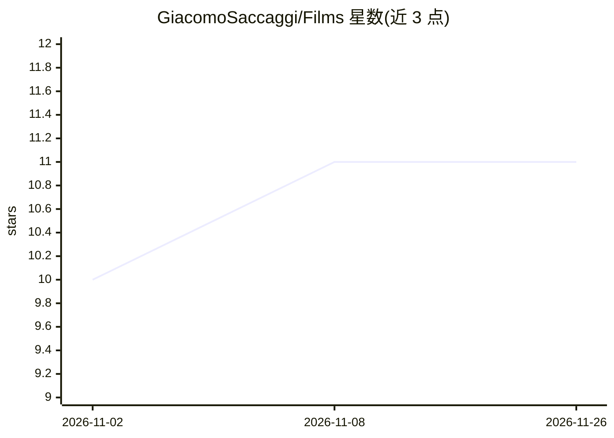

# GiacomoSaccaggi/Films

⭐ 11 · HTML · Apache-2.0 · 推送 2026-08-25 · [GitHub](https://github.com/GiacomoSaccaggi/Films) · 个人维护

**电影推荐系统：协同过滤与基于内容的方法**

基于 Python 的电影推荐系统，采用协同过滤（user-user、item-item）与基于内容的方法（类型、导演、演员），并包含 SVD 矩阵分解、观影模式分析与类型偏好建模。技术栈为 pandas/NumPy、scikit-learn、Surprise 推荐库，以 Jupyter Notebooks 形式组织，采用 MIT 许可。README 未提供安装步骤、运行说明或数据来源说明。

## 筛选速览

| 维度 | 判定 | 备注 |
|---|---|---|
| AI 角色 | `ai-native` | 本体是模型或模型工具 |
| 许可风险 | `permissive` | Apache-2.0 |
| 部署形态 | `None` |  |
| 模型依赖 | — | README 未给出锁定关系 |
| 硬件要求 | — | 无带数字的原话,不猜 |
| 安装摩擦 | `low` | 无编译、无系统依赖或容器化 |
| 成熟度 | — | 结构信号不足 |

## 能力要点

- 协同过滤实现（user-user 与 item-item）
- 基于内容的推荐（类型、导演、演员）
- SVD 矩阵分解与观影模式分析
- 以 Jupyter Notebooks 组织

## 适用场景

- 学习协同过滤与基于内容推荐的实现方式
- 分析用户观影模式与类型偏好

## 场景标签

`推荐系统` · 领域:学习与行业

## 证据(README 行号)

> L3: Movie recommendation system using collaborative filtering and content-based approaches.
> L7: - Collaborative filtering (user-user, item-item)

## 星数曲线

2026-11-02 10 → 2026-11-26 11（+1）

---
*卡片 v1 · prompt 1.4 · 生成 2026-11-19 · 置信度 mid · 依据 README sha `a969be70b026` · [字段定义](../../DATASET.md)*
