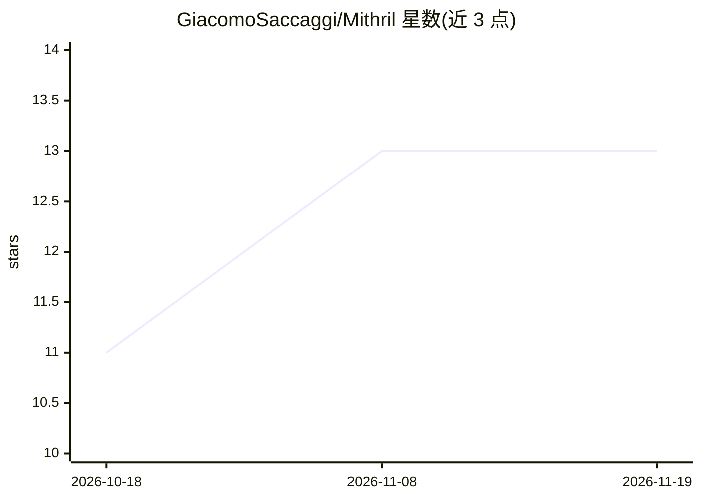

# GiacomoSaccaggi/Mithril

⭐ 13 · Rust · MIT · 推送 2026-11-11 · [GitHub](https://github.com/GiacomoSaccaggi/Mithril) · [官网](https://giacomosaccaggi.github.io/Mithril/) · 个人维护

**把多家 LLM 供应方编排为一个 Ollama 兼容 API 的后端引擎**

以 Rust 编写的多模型编排后端：用户在 YAML 中定义 fellowship（多模型团队，含 controller 与成员 agent），启动后对外暴露 Ollama、OpenAI 与 MCP 协议端点，任何 Ollama/OpenAI 兼容客户端可将整个团队当作一个模型调用。支持本地 GGUF（经 llama.cpp）、云 API（Gemini/OpenAI/Anthropic/Groq/JEV）与 CLI 工具作为供应方，agent 间通过 NEXT/TASK 协议委派任务，内置 24 个工具与终端沙箱，API key 经 Argon2id + AES-256-GCM 加密存储。v1.0 起仅做后端，不附带前端界面。

## 筛选速览

| 维度 | 判定 | 备注 |
|---|---|---|
| AI 角色 | `ai-ecosystem` | LLM/agent 周边工具 |
| 许可风险 | `permissive` | MIT |
| 部署形态 | `self-host` | docker 或自建部署 |
| 模型依赖 | local-ok | 支持本地模型 |
| 硬件要求 | — | 无带数字的原话,不猜 |
| 安装摩擦 | `low` | 无编译、无系统依赖或容器化 |
| 成熟度 | `idea` | |

## 能力要点

- 将多供应方模型组合为单一 Ollama/OpenAI/MCP 兼容端点
- YAML 定义 fellowship，agent 间用 NEXT/TASK 协议互相委派
- 24 个内置工具：文件、终端（沙箱）、Git、Web、代码符号等
- 供应方类型含本地 GGUF、云 API 与本地 CLI 工具子进程

## 适用场景

- 给 Junie/OpenCode/Open WebUI 当共享的多模型后端
- 在 Jupyter/Python 数据工作流里通过 OpenAI SDK 调用模型团队
- 用 Docker Compose 为团队部署共享编排服务
- 作为 MCP server 接入 Claude Desktop

## 场景标签

`多智能体` `模型网关` · 领域:Agent 开发

## 证据(README 行号)

> L5: **A multi-model orchestration backend.** Combine any mix of LLM providers (Gemini, OpenAI, Anthropic, Groq, JEV, loc
> L31: Now any Ollama-compatible client sees your fellowship as a model:
> L206: |Endpoint|Protocol|Use|

## 星数曲线

2026-10-18 11 → 2026-11-19 13（+2）

---
*卡片 v1 · prompt 1.4 · 生成 2026-11-18 · 置信度 high · 依据 README sha `d3c5ab6dc53d` · [字段定义](../../DATASET.md)*
