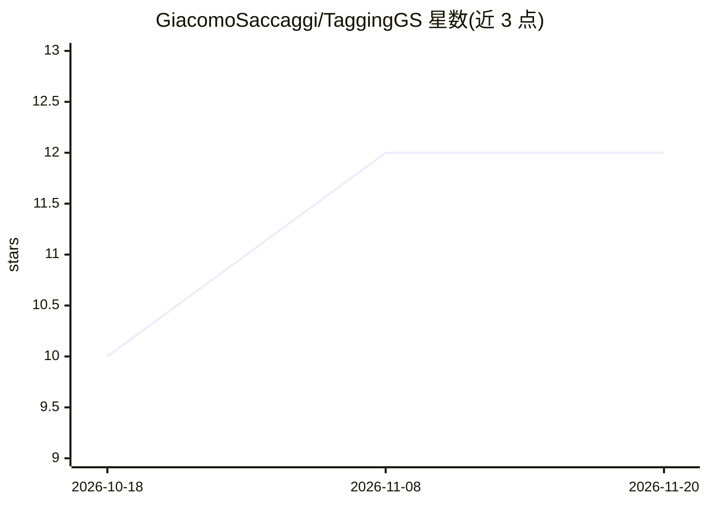

# GiacomoSaccaggi/TaggingGS

⭐ 12 · Python · NOASSERTION · 推送 2026-08-25 · [GitHub](https://github.com/GiacomoSaccaggi/TaggingGS) · 个人维护

**Web 应用：文本与图像自动打标签（ML 分类）**

基于 Flask 的 Web 应用，用户上传文本或图像后获得分类/标签预测。文本分类通过 spaCy 支持意大利语、英语、德语多语言 NLP；图像分类使用 TensorFlow/Keras 构建的 CNN；同时提供 scikit-learn 经典模型（随机森林、SVM、朴素贝叶斯）与无监督方法（主题建模、聚类）用于自动发现类别。交互界面支持上传、查看预测、复核并重新训练模型。README 未给出预训练模型或部署细节，需自行准备训练数据。

## 筛选速览

| 维度 | 判定 | 备注 |
|---|---|---|
| AI 角色 | `ai-native` | 本体是模型或模型工具 |
| 许可风险 | `none` | NOASSERTION |
| 部署形态 | `library` | 以包/库形式分发 |
| 模型依赖 | — | README 未给出锁定关系 |
| 硬件要求 | — | 无带数字的原话,不猜 |
| 安装摩擦 | `low` | 无编译、无系统依赖或容器化 |
| 成熟度 | — | 结构信号不足 |

## 能力要点

- 多语言文本分类（意大利语/英语/德语，spaCy）
- CNN 图像分类（TensorFlow/Keras）
- scikit-learn 经典模型与无监督主题建模/聚类
- 交互式 UI：上传→预测→复核→再训练

## 适用场景

- 对一批文本或图片自动打分类标签
- 用无监督聚类探索未标注数据的潜在主题
- 在界面中人工复核预测并迭代再训练模型

## 场景标签

`目标检测` · 领域:感知与多模态

## 证据(README 行号)

> L3: Flask web app for automated text and image tagging using supervised and unsupervised ML classification.
> L10: - **Interactive UI**: Upload content, get predictions, review and retrain

## 星数曲线

2026-10-18 10 → 2026-11-20 12（+2）

---
*卡片 v1 · prompt 1.4 · 生成 2026-11-18 · 置信度 high · 依据 README sha `adb672bfb526` · [字段定义](../../DATASET.md)*
