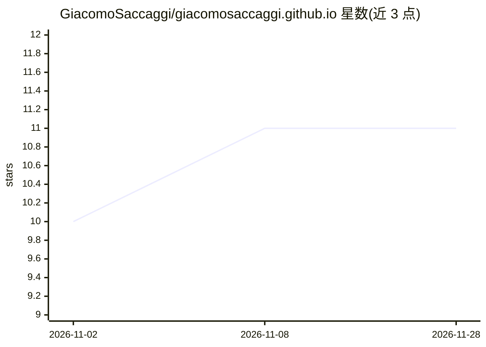

# GiacomoSaccaggi/giacomosaccaggi.github.io

⭐ 11 · HTML · 推送 2026-08-26 · [GitHub](https://github.com/GiacomoSaccaggi/giacomosaccaggi.github.io) · 个人维护

**个人数据科学作品集与博客站点**

基于 GitHub Pages 托管的个人作品集与博客网站，展示数据科学、机器学习与 AI 项目。页面包含项目展示（含交互式演示）、技术博客文章，以及基于 Plotly.js 与 D3.js 的数据可视化，采用 Bootstrap 5 实现响应式布局，前端为 HTML5/CSS3/JavaScript 与原生 JS，无后端组件。

## 筛选速览

| 维度 | 判定 | 备注 |
|---|---|---|
| AI 角色 | `ai-knowledge` | 知识聚合/清单类 |
| 许可风险 | `none` | — |
| 部署形态 | `None` |  |
| 模型依赖 | — | README 未给出锁定关系 |
| 硬件要求 | — | 无带数字的原话,不猜 |
| 安装摩擦 | `low` | 无编译、无系统依赖或容器化 |
| 成熟度 | — | 结构信号不足 |

## 能力要点

- 项目展示并附带交互式演示
- 基于 Plotly.js 与 D3.js 的数据可视化
- Bootstrap 5 响应式设计
- GitHub Pages 托管

## 适用场景

- 浏览作者的数据科学与机器学习项目
- 阅读技术博客文章
- 查看交互式数据可视化示例

## 场景标签

 · 领域:个人作品集/博客

## 证据(README 行号)

> L3: Personal portfolio and blog showcasing data science, machine learning, and AI projects.
> L9: - Data visualizations (Plotly, D3.js)

## 星数曲线

2026-11-02 10 → 2026-11-28 11（+1）

---
*卡片 v1 · prompt 1.4 · 生成 2026-11-19 · 置信度 high · 依据 README sha `3d20ccd1a5d8` · [字段定义](../../DATASET.md)*
