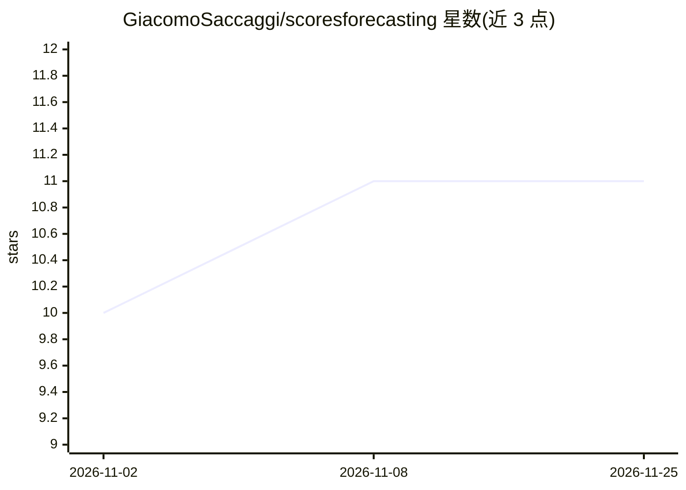

# GiacomoSaccaggi/scoresforecasting

⭐ 11 · HTML · 推送 2026-08-25 · [GitHub](https://github.com/GiacomoSaccaggi/scoresforecasting) · 个人维护

**用统计与机器学习模型预测体育比赛比分**

一个体育比分预测项目，方法包括泊松回归建模进球、球队表现的时间序列分析、Elo 评分系统实现、集成方法预测比赛结果，以及蒙特卡洛模拟锦标赛对阵。基于 Python 实现，依赖 statsmodels、scikit-learn、pandas/NumPy 与 Matplotlib/Plotly，采用 MIT 许可。README 未给出安装步骤与使用说明。

## 筛选速览

| 维度 | 判定 | 备注 |
|---|---|---|
| AI 角色 | `ai-native` | 本体是模型或模型工具 |
| 许可风险 | `none` | — |
| 部署形态 | `None` |  |
| 模型依赖 | — | README 未给出锁定关系 |
| 硬件要求 | — | 无带数字的原话,不猜 |
| 安装摩擦 | `low` | 无编译、无系统依赖或容器化 |
| 成熟度 | — | 结构信号不足 |

## 能力要点

- 泊松回归建模进球数
- Elo 评分系统实现与球队表现时间序列分析
- 集成方法预测比赛结果，蒙特卡洛模拟锦标赛对阵

## 适用场景

- 预测足球比赛的比分与胜负结果
- 通过蒙特卡洛模拟推演锦标赛晋级 bracket

## 场景标签

 · 领域:体育分析/预测

## 证据(README 行号)

> L3: Sports score prediction using statistical models and machine learning.
> L7: - Poisson regression for goal modeling

## 星数曲线

2026-11-02 10 → 2026-11-25 11（+1）

---
*卡片 v1 · prompt 1.4 · 生成 2026-11-19 · 置信度 mid · 依据 README sha `d8b448ffb751` · [字段定义](../../DATASET.md)*
