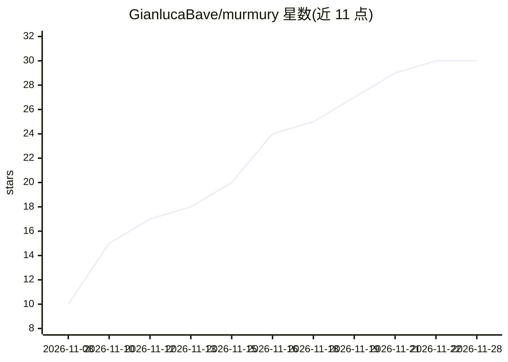

# GianlucaBave/murmury

⭐ 30 · Python · GPL-3.0 · 推送 2026-11-26 · [GitHub](https://github.com/GianlucaBave/murmury) · [官网](https://murmury.pages.dev) · 个人维护

**视频通话期间从自有文档实时生成答案、屏幕共享不可见的 Mac 工具**

macOS（Apple Silicon）桌面应用：通过 ScreenCaptureKit 在本机捕获系统音频，用本地 Whisper（mlx-whisper）转写对方提问，结合用户预先添加的 PDF/Excel/Word 等文档生成带出处的回答，显示在一个被排除于屏幕共享与录屏之外的悬浮窗口。回答模型可用自有 API key（Anthropic/OpenAI/Gemini/xAI/Groq/Mistral/OpenRouter）或本地 Ollama/LM Studio。提供 dmg 安装包与源码运行两种途径；README 明确提醒录音转写的法律风险，并声明勿用于考试与面试。

## 筛选速览

| 维度 | 判定 | 备注 |
|---|---|---|
| AI 角色 | `ai-native` | 本体是模型或模型工具 |
| 许可风险 | `viral` | GPL-3.0 |
| 部署形态 | `desktop` | 安装包/桌面程序 |
| 模型依赖 | local-ok | 支持本地模型 |
| 硬件要求 | — | 无带数字的原话,不猜 |
| 安装摩擦 | `low` | 无编译、无系统依赖或容器化 |
| 成熟度 | — | 结构信号不足 |

## 能力要点

- 本地 Whisper 转写，音频不出本机；仅提问文本与文档发给所选模型
- 窗口经 NSWindowSharingNone 排除在 Zoom/Meet/Teams 屏幕共享与录屏之外（含验证脚本）
- 回答仅基于用户文档，逐条标注出处（页/表/单元格）
- 支持自有 key 的 7 家云服务或 Ollama/LM Studio 本地模型（含指向另一台机器）

## 适用场景

- 投资人会议、客户演示或谈判前加载相关文档，通话中实时获得有出处的回答
- 不加入会议机器人、不在对方界面留下录音标记地获取提问转写
- 配合本机 Ollama/LM Studio 实现全程不出 Mac 的私密问答

## 场景标签

`文档问答` `AI 助手` · 领域:对话与助手

## 证据(README 行号)

> L33: Speech is transcribed on your Mac with Whisper. No bot joins the call and nothing is saved. With Ollama or LM Studi
> L64: - **No bot joins the meeting.** Audio is read inside macOS with ScreenCaptureKit, so nothing
> L72: - **Answers come from your documents only.** Every bullet names its source (section, table, sheet

## 星数曲线

2026-11-08 10 → 2026-11-28 30（+20）

---
*卡片 v1 · prompt 1.4 · 生成 2026-11-18 · 置信度 high · 依据 README sha `401890b54a15` · [字段定义](../../DATASET.md)*
