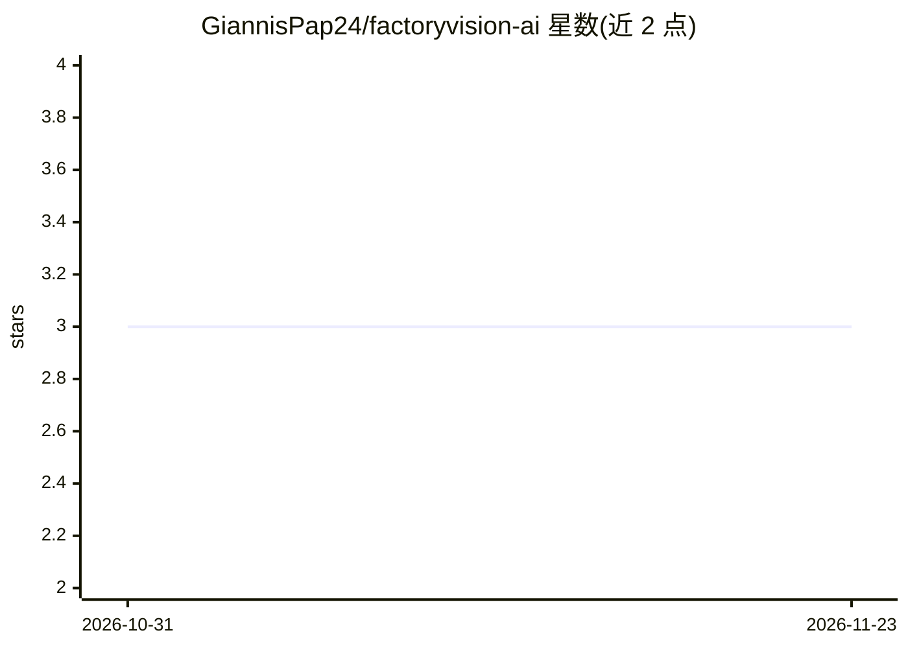

# GiannisPap24/factoryvision-ai

⭐ 3 · Python · MIT · 推送 2026-11-08 · [GitHub](https://github.com/GiannisPap24/factoryvision-ai) · 个人维护

**给研究者的本地视觉异常检测研究应用：PyTorch+Streamlit 六种方法**

基于 PyTorch 与 Streamlit 的本地视觉异常检测研究应用，注册六种方法（四种 Cashew 方法：autoencoder、空间基线、ResNet18 特征记忆、student–teacher，及两种 MetalParts 方法）。仓库本身不含数据集、checkpoint 或预训练权重；装好后可运行合成 demo、模型目录与人工复核练习，真正的推理需用户自行提供并通过 SHA-256 校验的本地工件。支持单图 CPU 推理、热力图、最多 20 张图的批量检查及 CSV/JSON 报告。明确声明为研究演示，不用于工业验收或食品安全判定。

## 筛选速览

| 维度 | 判定 | 备注 |
|---|---|---|
| AI 角色 | `ai-native` | 本体是模型或模型工具 |
| 许可风险 | `permissive` | MIT |
| 部署形态 | `desktop` | 安装包/桌面程序 |
| 模型依赖 | — | README 未给出锁定关系 |
| 硬件要求 | — | 无带数字的原话,不猜 |
| 安装摩擦 | `low` | 无编译、无系统依赖或容器化 |
| 成熟度 | — | 结构信号不足 |

## 能力要点

- 六种注册异常检测方法与 Model Registry V1（版本、来源、八份历史证据摘要）
- 八个工作区：Overview/Inspect/Compare/Batch Inspection/Reports 等
- 批量检查最多 20 张图，输出确定性 CSV/JSON 报告与保留错误行
- 上传仅留在进程内存，绑定 localhost，禁用遥测

## 适用场景

- 在本地复现工业图像异常检测研究方法
- 对少量图像做批量推理并导出 CSV/JSON 研究报告
- 通过合成 demo 熟悉异常检测工作流而无需模型权重

## 场景标签

`图像视频处理` · 领域:感知与多模态

## 证据(README 行号)

> L7: **A local visual anomaly inspection research app built with PyTorch and Streamlit.**
> L35: - Six registered methods: four Cashew methods (autoencoder, spatial baseline, ResNet18 feature memory and student–t

## 星数曲线

2026-10-31 3 → 2026-11-23 3（+0）

---
*卡片 v1 · prompt 1.4 · 生成 2026-11-22 · 置信度 high · 依据 README sha `35dc31b33300` · [字段定义](../../DATASET.md)*
