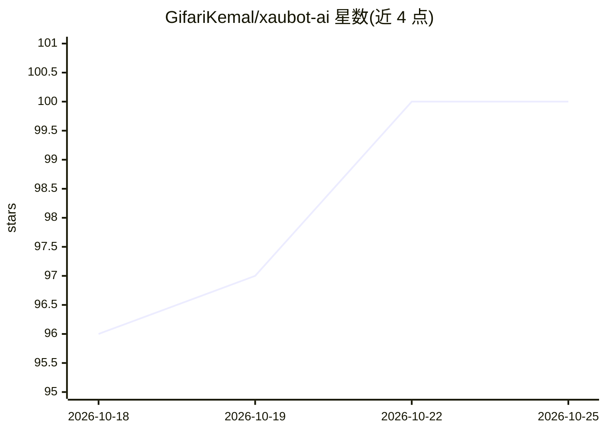

# GifariKemal/xaubot-ai

⭐ 100 · Python · MIT · 推送 2026-02-11 · [GitHub](https://github.com/GifariKemal/xaubot-ai) · 个人维护

**面向 MetaTrader 5 的 XAUUSD 黄金 AI 交易机器人**

Python 编写的 XAUUSD（黄金）自动交易机器人，运行于 MetaTrader 5 平台：用 37 特征的 XGBoost 模型预测 BUY/SELL/HOLD，结合 Smart Money Concepts（Order Block/FVG/BOS）与 3 状态 Hidden Markov Model 判别市场 regime（trending/ranging/volatile）。风险管理层含 ATR 止损、Kelly 仓位、每日/总亏损上限与时段/点差过滤；数据管道用 Polars，配 Next.js 网页监控面板与 Telegram 通知。README 声明仅供教育与研究目的，手动运行需 Windows MT5 终端与 Python 3.11+。

## 筛选速览

| 维度 | 判定 | 备注 |
|---|---|---|
| AI 角色 | `ai-native` | 本体是模型或模型工具 |
| 许可风险 | `permissive` | MIT |
| 部署形态 | `None` |  |
| 模型依赖 | — | README 未给出锁定关系 |
| 硬件要求 | — | 无带数字的原话,不猜 |
| 安装摩擦 | `low` | 无编译、无系统依赖或容器化 |
| 成熟度 | — | 结构信号不足 |

## 能力要点

- 37 特征 XGBoost 模型输出 BUY/SELL/HOLD 预测与校准置信度
- HMM 3 状态市场 regime 检测与 SMC 结构分析
- ATR 止损、Kelly 仓位、日亏 5%/总亏 10% 上限等风控规则
- 模型市况变化时自动重训练，附 Next.js 实时监控面板

## 适用场景

- 在 MetaTrader 5 上自动化交易 XAUUSD 品种
- 用机器学习信号结合 SCM/HMM regime 做交易决策
- 通过网页面板与 Telegram 跟踪实时交易与每日汇总

## 场景标签

`金融量化` · 领域:学习与行业

## 证据(README 行号)

> L3: **Bot trading XAUUSD (Emas) berbasis AI** dengan *XGBoost ML*, *Smart Money Concepts* (SMC), dan deteksi *regime* me
> L13: |**Model *XGBoost ML***|Model 37-fitur yang memprediksi BUY/SELL/HOLD dengan *confidence* terkalibrasi|

## 星数曲线

2026-10-18 96 → 2026-10-25 100（+4）

---
*卡片 v1 · prompt 1.4 · 生成 2026-10-23 · 置信度 high · 依据 README sha `2d60d415224e` · [字段定义](../../DATASET.md)*
