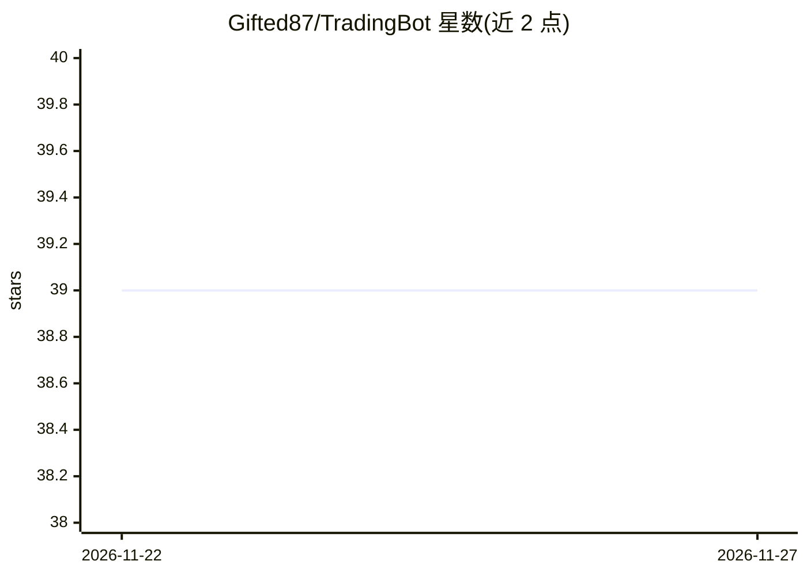

# Gifted87/TradingBot

⭐ 39 · Python · 推送 2026-11-21 · [GitHub](https://github.com/Gifted87/TradingBot) · 个人维护

**多智能体 AI 金融行情分析系统：输出交易信号供研究参考**

基于 Flask + Celery + Redis 的多智能体行情分析程序：用户选择资产后，系统拉取 90 天 OHLC 数据，并行运行 SMC 与 Wyckoff 两个分析 agent、两个交叉校验的 critic agent，再由 Metareasoning Consolidator 汇总生成含入场/止损/止盈的交易信号，通过 SSE 实时推送到网页仪表盘。AI 调用为模型无关的 OpenAI 兼容接口，LLM 提供商与模型可在 .env 中配置；市场数据依赖 RealMarketAPI 的 API key。README 声明仅供研究教育用途，不构成投资建议。

## 筛选速览

| 维度 | 判定 | 备注 |
|---|---|---|
| AI 角色 | `ai-native` | 本体是模型或模型工具 |
| 许可风险 | `none` | — |
| 部署形态 | `library` | 以包/库形式分发 |
| 模型依赖 | locked-api |  |
| 硬件要求 | — | 无带数字的原话,不猜 |
| 安装摩擦 | `low` | 无编译、无系统依赖或容器化 |
| 成熟度 | — | 结构信号不足 |

## 能力要点

- SMC 与 Wyckoff 双分析师 + 双 critic 交叉校验 + 汇总器合并为单一交易信号
- 模型无关设计：标准 OpenAI 兼容 completions，支持 prompt caching 的提供商可降低 token 开销
- Celery + Redis 任务队列，最多 3 个分析并行，任务状态在页面刷新后保留
- 内置仓位计算器与回测模式（可选历史日期分析）

## 适用场景

- 对黄金、外汇、加密货币等资产做多智能体技术面分析
- 本地部署一个可视化的多 agent 分析流水线学习 SMC/Wyckoff 方法
- 通过队列 API 将分析任务接入自己的工作流

## 场景标签

`多智能体` `金融量化` · 领域:Agent 开发

## 证据(README 行号)

> L3: > A multi-agent AI system that analyses Forex, Crypto, Commodities, and Indices using Smart Money Concepts and Wycko
> L17: 5. **Runs a Metareasoning Consolidator** that reads both final reports, resolves any disagreements, and outputs a s
> L31: **All AI calls are model-agnostic and use standard OpenAI-compatible completions.** Prompts are ordered such that s

## 星数曲线

2026-11-22 39 → 2026-11-27 39（+0）

---
*卡片 v1 · prompt 1.4 · 生成 2026-11-22 · 置信度 high · 依据 README sha `2a0b10f2427f` · [字段定义](../../DATASET.md)*
