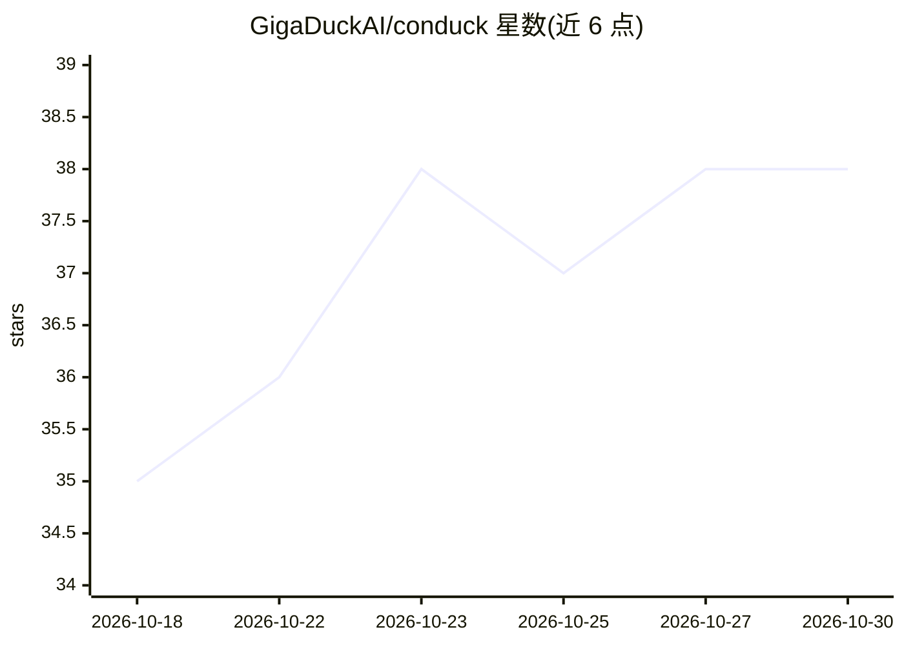

# GigaDuckAI/conduck

⭐ 38 · Swift · Apache-2.0 · 推送 2026-10-05 · [GitHub](https://github.com/GigaDuckAI/conduck) · [官网](https://conduck.com) · 组织维护

**跨 Apple 设备的原生 AI 聊天客户端：自带密钥直连你选的模型**

面向 iPhone/iPad/Mac/Apple Watch/CarPlay 的原生聊天客户端，自身不含模型也不设中间服务器：用户以自己的 API key 直连 OpenRouter、自建的 Ollama/LM Studio 或任意 OpenAI 兼容服务端，还可通过 conduck-connect 接入 agent 网关。对话经用户私有 iCloud（CloudKit/Keychain）跨设备同步，密钥存于 Keychain。语音转录默认用 Apple 端上语音。提供 App Store 官方版与 Apache-2.0 源码自建两种获取方式；需 iOS/iPadOS/macOS/watchOS 26.5+，Mac 版需 Apple silicon。

## 筛选速览

| 维度 | 判定 | 备注 |
|---|---|---|
| AI 角色 | `ai-native` | 本体是模型或模型工具 |
| 许可风险 | `permissive` | Apache-2.0 |
| 部署形态 | `None` |  |
| 模型依赖 | local-ok | 支持本地模型 |
| 硬件要求 | — | 无带数字的原话,不猜 |
| 安装摩擦 | `low` | 无编译、无系统依赖或容器化 |
| 成熟度 | — | 结构信号不足 |

## 能力要点

- 自带密钥直连用户选择的模型端点或 agent 网关，无 Conduck 服务器中转
- 五种 Apple 设备（含 CarPlay）共享同一对话，经私有 iCloud 同步
- Action Button/控制中心/快捷指令/菜单栏/Watch/CarPlay 多入口唤起
- 代码 Apache-2.0 开源，官方 App 与自建版同源

## 适用场景

- 在自己的 Apple 设备上使用 OpenRouter 或自建模型聊天
- 在 Mac 上开始对话、在 Watch 上继续查看
- 把自己运行的 Ollama/LM Studio 服务接到手机上用

## 场景标签

`AI 助手` · 领域:对话与助手

## 证据(README 行号)

> L7:  The native Apple client for the AI you choose — your own server, a local model, or OpenRouter.
> L22: Conduck is the app, not the AI. There is no model inside it and no Conduck account to create: you connect the AI yo
> L44:  Requires iOS, iPadOS, macOS, and watchOS 26.5 or later. The Mac app needs Apple silicon. CarPlay runs through the 

## 星数曲线

2026-10-18 35 → 2026-10-30 38（+3）

---
*卡片 v1 · prompt 1.4 · 生成 2026-10-25 · 置信度 high · 依据 README sha `477819f16262` · [字段定义](../../DATASET.md)*
