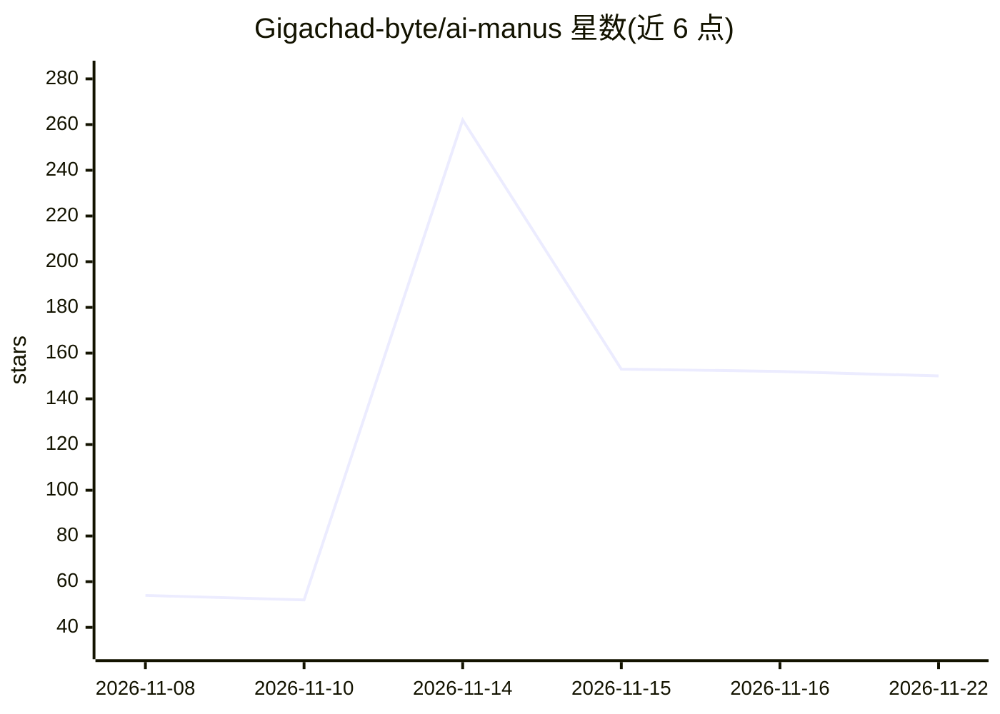

# Gigachad-byte/ai-manus

⭐ 150 · Python · Apache-2.0 · 推送 2026-11-08 · [GitHub](https://github.com/Gigachad-byte/ai-manus) · 个人维护

**自主 AI Agent 系统：在沙箱中运行工具、执行代码并控制浏览器**

README 以产品介绍形式描述一个通用自主 AI Agent：代理可自行编写并执行脚本、控制浏览器完成导航与表单填写、执行多步骤任务，供学生、远程工作者与轻量办公场景用户委派重复性工作。提供兼容性表（最低 4 GB 内存、双核 CPU）与上手步骤说明。README 未包含安装命令、依赖说明、代码结构或部署方式等可验证的工程细节，仓库描述提到在沙箱环境中运行各类工具。

## 筛选速览

| 维度 | 判定 | 备注 |
|---|---|---|
| AI 角色 | `ai-native` | 本体是模型或模型工具 |
| 许可风险 | `permissive` | Apache-2.0 |
| 部署形态 | `None` |  |
| 模型依赖 | — | README 未给出锁定关系 |
| 硬件要求 | — | 无带数字的原话,不猜 |
| 安装摩擦 | `low` | 无编译、无系统依赖或容器化 |
| 成熟度 | — | 结构信号不足 |

## 能力要点

- 自主执行代码与脚本完成多步骤任务
- 浏览器控制：导航网页、填写表单、采集信息
- 代码与浏览器操作可在同一任务流中衔接
- 面向家庭、学习与轻量办公的小规模场景

## 适用场景

- 让代理自动完成重复性的代码运行与小脚本任务
- 自动浏览网页、填表并汇总多页面信息
- 学生与远程工作者委派日常琐碎任务

## 场景标签

`AI 助手` `浏览器自动化` · 领域:效率与自动化

## 证据(README 行号)

> L10: - **Autonomous Code Execution:** Manus AI agent runs code on its own to complete tasks, so you can focus on decisio
> L18: Manus is an autonomous AI agent designed to run code and control a browser on your behalf. Instead of acting like a

## 星数曲线

2026-11-08 54 → 2026-11-22 150（+96）

---
*卡片 v1 · prompt 1.4 · 生成 2026-11-17 · 置信度 low · 依据 README sha `790070d90930` · [字段定义](../../DATASET.md)*
