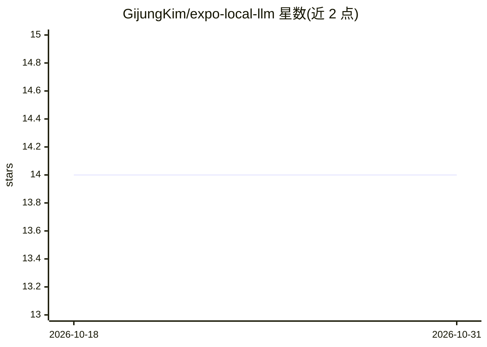

# GijungKim/expo-local-llm

⭐ 14 · TypeScript · MIT · 推送 2026-10-29 · [GitHub](https://github.com/GijungKim/expo-local-llm) · [官网](https://www.npmjs.com/package/expo-local-llm) · 个人维护

**Expo 模块：在 iOS/Android 应用内调用系统自带端侧 LLM**

为 Expo/React Native 应用提供的原生模块，接入操作系统内置模型——iOS 26+ 的 Apple Foundation Models 与 Android 的 Gemini Nano——实现文本生成、流式输出、schema 约束的结构化输出与工具调用，无需打包模型权重、API key 或联网。无运行时依赖，通过 useLocalLLM hook 与 generate/createLLMSession API 暴露稳定错误码与能力探测。限制：需原生开发构建（Expo Go 不可用），结构化输出与工具调用仅 iOS 支持，Android 端生成功能尚未在真机验证（标记 experimental），多数 Android 设备报告 notEligible。

## 筛选速览

| 维度 | 判定 | 备注 |
|---|---|---|
| AI 角色 | `ai-ecosystem` | LLM/agent 周边工具 |
| 许可风险 | `permissive` | MIT |
| 部署形态 | `library` | 以包/库形式分发 |
| 模型依赖 | — | README 未给出锁定关系 |
| 硬件要求 | — | 无带数字的原话,不猜 |
| 安装摩擦 | `low` | 无编译、无系统依赖或容器化 |
| 成熟度 | `idea` | |

## 能力要点

- 接入 iOS Foundation Models 与 Android Gemini Nano，模型由系统管理、无需打包权重
- schema 约束的结构化输出与工具调用（iOS，约束解码）
- getCapabilities() 运行时能力探测与稳定错误码
- 无运行时依赖，流式输出、取消、会话重置齐全

## 适用场景

- 在 Expo 应用中离线生成文本或流式对话
- 从用户输入提取符合 schema 的结构化数据
- 通过工具调用让应用内模型触发本地功能

## 场景标签

`推理引擎` · 领域:训练与推理

## 证据(README 行号)

> L8: On-device language models for Expo apps, using the models the operating system already ships: Apple Foundation Model
> L27: npx expo install expo-local-llm expo-dev-client expo-build-properties
> L190: Returns `platform`, `backend`, `status`, boolean `text`/`streaming`/`tools`/`structuredOutput` flags, `structuredO

## 星数曲线

2026-10-18 14 → 2026-10-31 14（+0）

---
*卡片 v1 · prompt 1.4 · 生成 2026-10-31 · 置信度 high · 依据 README sha `be8ad468e405` · [字段定义](../../DATASET.md)*
