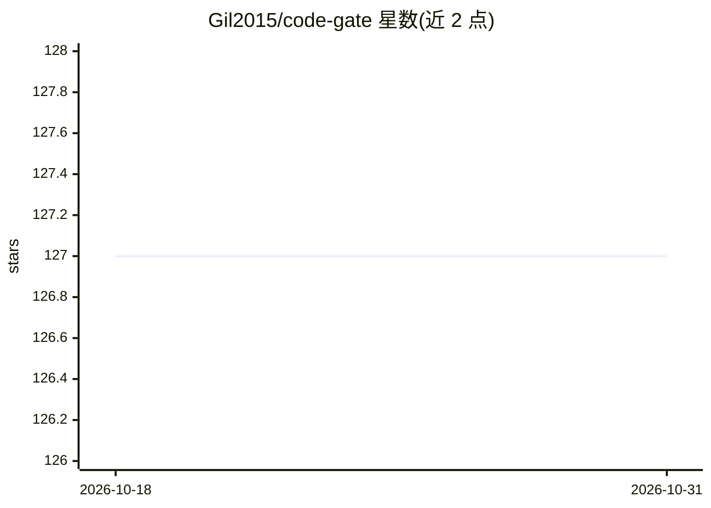

# Gil2015/code-gate

⭐ 127 · TypeScript · MIT · 推送 2026-05-08 · [GitHub](https://github.com/Gil2015/code-gate) · 个人维护 · 中文 README

**给开发者的 Git 提交 AI 代码审查 CLI 工具**

集成进 Git 工作流的代码审查工具：在 git commit 时自动分析暂存的代码变更，使用本地 Ollama 模型或云端 API（DeepSeek、OpenAI、Anthropic、Aliyun、Volcengine、Zhipu 等）输出代码质量、安全建议与优化方案，并生成 HTML 可视化报告与审查日志归档。提供 npx 零安装、npm 依赖集成与 Git Hook（原生/Husky）三种接入方式。Agent 模式（仅 DeepSeek 与 Zhipu）可读取文件、搜索定义、浏览目录以获取上下文，但会增加 token 消耗。

## 筛选速览

| 维度 | 判定 | 备注 |
|---|---|---|
| AI 角色 | `ai-native` | 本体是模型或模型工具 |
| 许可风险 | `permissive` | MIT |
| 部署形态 | `library` | 以包/库形式分发 |
| 模型依赖 | local-ok | 支持本地模型 |
| 硬件要求 | — | 无带数字的原话,不猜 |
| 安装摩擦 | `low` | 无编译、无系统依赖或容器化 |
| 成熟度 | — | 结构信号不足 |

## 能力要点

- git commit 时自动审查暂存变更，支持原生 Git Hooks 与 Husky
- 默认使用 Ollama 本地模型，支持 8 家云端 Provider
- Agent 模式可主动读取文件/搜索定义/浏览目录获取上下文（仅 DeepSeek 与 Zhipu）
- 生成 HTML 可视化报告并自动归档审查历史

## 适用场景

- 提交前自动审查代码变更，获取质量与安全建议
- 使用本地 Ollama 模型在私有环境做代码审查
- 通过脚本命令手动审查指定 commit

## 场景标签

`代码审查` · 领域:编码与开发

## 证据(README 行号)

> L13: Code Gate is an intelligent code review tool seamlessly integrated into your Git workflow. When you run `git commit
> L25: - **🤖 Agent Mode**: AI can actively retrieve code context (file contents, search definitions, browse directories) f

## 星数曲线

2026-10-18 127 → 2026-10-31 127（+0）

---
*卡片 v1 · prompt 1.4 · 生成 2026-10-23 · 置信度 high · 依据 README sha `ae69df5780ec` · [字段定义](../../DATASET.md)*
