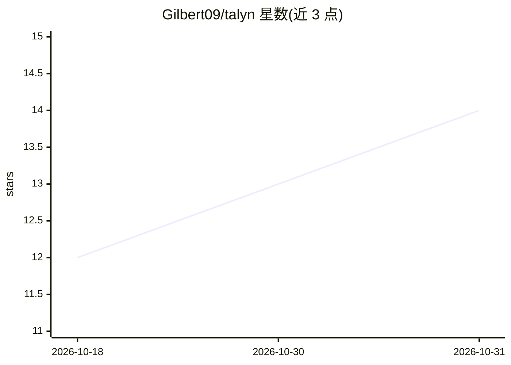

# Gilbert09/talyn

⭐ 14 · TypeScript · NOASSERTION · 推送 2026-10-30 · [GitHub](https://github.com/Gilbert09/talyn) · [官网](https://talyn.dev) · 个人维护

**AI 云编码代理驱动的 GitHub PR 管控与自动修复工具**

面向 GitHub 用户的 PR 管理与自动化工具：汇总全部开放 PR 并按需关注程度排序，将失败 CI、合并冲突与 review 评论分派给云端编码代理（运行在自有沙箱 microVM 中）修复，并提供合并队列按序落盘、代码审查（结论仅在应用内）、工作流触发、定时 Loops、SKILL.md 技能运行与 MCP 服务器接入。代理运行在用户已有的 Claude/ChatGPT 订阅或 PostHog Code 上，不产生额外 token 账单。提供桌面端（Electron）与浏览器版本；处于公开 beta，仅支持 GitHub，无团队功能。

## 筛选速览

| 维度 | 判定 | 备注 |
|---|---|---|
| AI 角色 | `ai-ecosystem` | LLM/agent 周边工具 |
| 许可风险 | `permissive` | NOASSERTION |
| 部署形态 | `desktop` | 安装包/桌面程序 |
| 模型依赖 | locked-api |  |
| 硬件要求 | — | 无带数字的原话,不猜 |
| 安装摩擦 | `low` | 无编译、无系统依赖或容器化 |
| 成熟度 | `idea` | |

## 能力要点

- 云端代理在自有 Firecracker microVM 沙箱中修复失败 CI、冲突与 review 评论
- 合并队列自动 rebase、清冲突、并发落盘 PR
- 代理运行于用户已有 Claude/ChatGPT 订阅，无第二份 API 账单
- SKILL.md 技能、MCP 服务器接入与定时 Loops

## 适用场景

- 团队开发者用 AI 代理批量修复失败或过期的 PR
- 自动保持 PR 可合并并按序落盘
- 在应用内做多视角代码审查并一键提交修复 commit

## 场景标签

`编码 Agent` `代码审查` · 领域:编码与开发

## 证据(README 行号)

> L10: one list, worst first, and sends an AI coding agent to fix them — the failing tests, the merge
> L123: Talyn conducts the coding agents you already trust rather than replacing them. Every provider sits
> L128: Sign in with **Claude** or **ChatGPT** and your tasks run on that subscription. No API bill on top,

## 星数曲线

2026-10-18 12 → 2026-10-31 14（+2）

---
*卡片 v1 · prompt 1.4 · 生成 2026-10-31 · 置信度 high · 依据 README sha `c85f448c7bca` · [字段定义](../../DATASET.md)*
