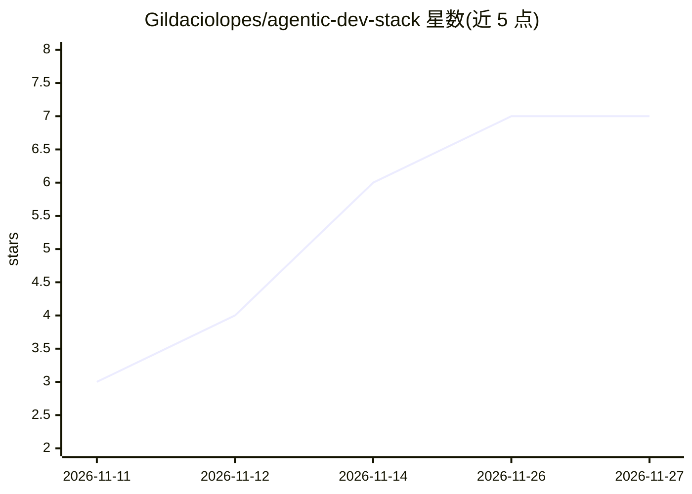

# Gildaciolopes/agentic-dev-stack

⭐ 7 · TypeScript · MIT · 推送 2026-11-23 · [GitHub](https://github.com/Gildaciolopes/agentic-dev-stack) · [官网](https://github.com/Gildaciolopes/agentic-dev-stack/blob/main/docs/00-smart-vibe-coding.md) · 个人维护

**为 Claude Code 用户提供多模型编排与省 token 的开发栈**

一套通过 npx 安装向导部署的 Claude Code 配置集合：Opus 作为 lead 负责规划，Sonnet/Haiku/Gemini/免费模型作为子代理执行不同任务，alethe 编排器管理各任务的模型分配、配额监控与成本报告；包含 Spec Kit 规范驱动开发、caveman+RTK+graphify 三个省 token 组件、内核沙箱隔离免费模型 worker、每日三次探测免费模型可用性的 curator，以及向 Discord/Telegram 推送摘要的 Hermes 助手。支持 macOS/Linux 完整功能，Windows 核心功能可用（免费 worker 需 WSL2）。

## 筛选速览

| 维度 | 判定 | 备注 |
|---|---|---|
| AI 角色 | `ai-ecosystem` | LLM/agent 周边工具 |
| 许可风险 | `permissive` | MIT |
| 部署形态 | `library` | 以包/库形式分发 |
| 模型依赖 | locked-api |  |
| 硬件要求 | — | 无带数字的原话,不猜 |
| 安装摩擦 | `low` | 无编译、无系统依赖或容器化 |
| 成熟度 | — | 结构信号不足 |

## 能力要点

- 多代理编排：Opus 规划、Sonnet/Haiku/Gemini/免费模型分工执行，worktree 隔离并行
- 省 token 层：RTK 压缩 shell 输出、caveman 精简回复、graphify 用代码知识图替代整仓阅读
- curator 每天 3 次探测免费模型并自动重写组合，沙箱阻止免费模型读取 .env/密钥
- Hermes 助手每天向 Discord/Telegram 推送摘要与当日 3 项优先任务

## 适用场景

- 在 Claude Code 中用多个模型并行执行规划好的开发任务
- 降低 Claude 配额消耗，把重读取与机械编辑分流到免费模型
- 通过 Telegram/Discord 远程了解项目进展与优先任务

## 场景标签

`多智能体` `编码 Agent` · 领域:Agent 开发

## 证据(README 行号)

> L9: > **Stop running one AI agent at a time.** This is a production-ready setup for Claude Code:
> L15: > It includes spec-driven development with GitHub Spec Kit, token savings with caveman + RTK + graphify, multi-agen
> L86: |**alethe**|Orchestrator: playbooks, model per task, quota watch, provider switch, cost report|Turns "use more agen

## 星数曲线

2026-11-11 3 → 2026-11-27 7（+4）

---
*卡片 v1 · prompt 1.4 · 生成 2026-11-20 · 置信度 high · 依据 README sha `01b51a6fbe7d` · [字段定义](../../DATASET.md)*
