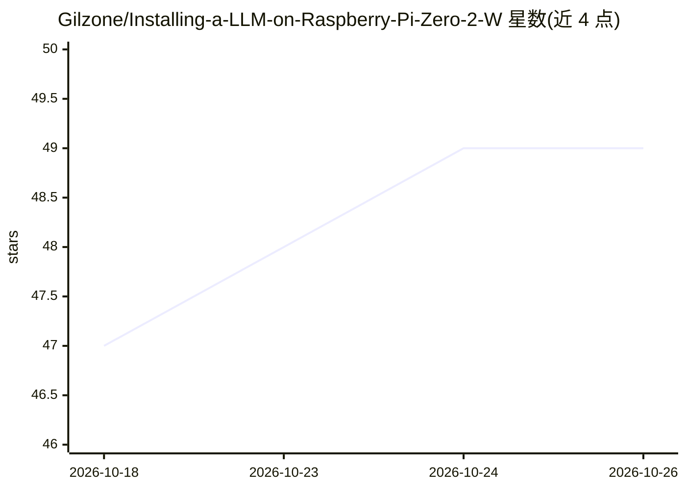

# Gilzone/Installing-a-LLM-on-Raspberry-Pi-Zero-2-W

⭐ 49 · 推送 2026-09-02 · [GitHub](https://github.com/Gilzone/Installing-a-LLM-on-Raspberry-Pi-Zero-2-W) · 个人维护

**树莓派 Zero 2 W 上部署本地 LLM 的教程指南**

一份在 512MB 内存的 Raspberry Pi Zero 2 W 上运行本地 LLM 的分步指南：刷入 64 位 Raspberry Pi OS Lite，调整 swap 与 swappiness 防止 OOM，可选超频至 1.1GHz，通过官方脚本安装 Ollama，并拉取 SmolLM2 135M 4-bit 量化模型运行对话。附内存预算、推理速度（约 3.2–5.5 tokens/sec）等实测数据、局域网 API 访问方法与故障排查。面向想在超低成本硬件上体验离线 AI 的爱好者。

## 筛选速览

| 维度 | 判定 | 备注 |
|---|---|---|
| AI 角色 | `ai-knowledge` | 知识聚合/清单类 |
| 许可风险 | `none` | — |
| 部署形态 | `None` |  |
| 模型依赖 | — | README 未给出锁定关系 |
| 硬件要求 | — | 无带数字的原话,不猜 |
| 安装摩擦 | `low` | 无编译、无系统依赖或容器化 |
| 成熟度 | — | 结构信号不足 |

## 能力要点

- 覆盖刷机、swap/内核优化、超频、Ollama 安装的完整流程
- SmolLM2 135M 4-bit 量化模型在 512MB RAM 实测约 3.2–5.5 tokens/sec
- 给出 Ollama 11434 端口 REST API 的局域网访问示例
- 附 OOM、高温等故障排查条目

## 适用场景

- 在树莓派 Zero 2 W 上离线运行对话式 LLM
- 把旧 Pi 板改造成局域网内可访问的推理 API 节点
- 学习低内存设备上的 swap 与超频调优方法

## 场景标签

`教程课程` · 领域:学习与行业

## 证据(README 行号)

> L10: A complete, battle-tested guide to running a local Large Language Model (LLM) on the ultra-budget **Raspberry Pi Ze
> L51: ## 🚀 Step-by-Step Setup Guide

## 星数曲线

2026-10-18 47 → 2026-10-26 49（+2）

---
*卡片 v1 · prompt 1.4 · 生成 2026-10-25 · 置信度 high · 依据 README sha `79e7c5bf96f7` · [字段定义](../../DATASET.md)*
