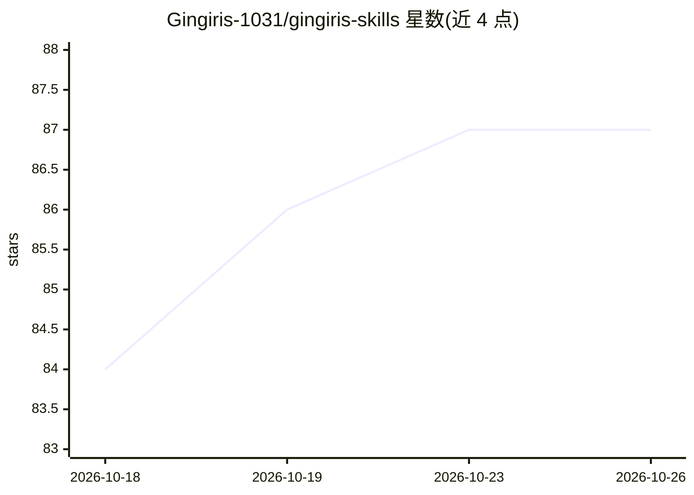

# Gingiris-1031/gingiris-skills

⭐ 87 · Python · MIT · 推送 2026-10-15 · [GitHub](https://github.com/Gingiris-1031/gingiris-skills) · 个人维护 · 中文 README

**面向出海增长运营者的 61 个 Claude Code 技能合集**

收录 61 个可复用 Claude Code 技能的 monorepo，覆盖 SEO/GEO、产品发布、开源营销、B2B 增长、用户访谈、Product Hunt 发售等出海增长场景，分为核心增长 Playbook 与执行技能（gr-*）两组，并附技能路由入口。通过 npx skills add 一键安装全部或单个技能，提供英/中/日/韩四语说明。社区与 599 元资料包为可选付费项，不影响开源技能的安装使用；Hosted Pro 服务为独立商业产品。

## 筛选速览

| 维度 | 判定 | 备注 |
|---|---|---|
| AI 角色 | `ai-knowledge` | 知识聚合/清单类 |
| 许可风险 | `permissive` | MIT |
| 部署形态 | `library` | 以包/库形式分发 |
| 模型依赖 | — | README 未给出锁定关系 |
| 硬件要求 | — | 无带数字的原话,不猜 |
| 安装摩擦 | `low` | 无编译、无系统依赖或容器化 |
| 成熟度 | — | 结构信号不足 |

## 能力要点

- 61 个 Claude Code 技能，覆盖 SEO/GEO、B2B 增长、产品发布等场景
- npx skills add 一条命令安装全部或单个技能
- 英/中/日/韩四语 README
- 内容标注为真实操盘经验提炼（34 个大使项目、937 次用户访谈）

## 适用场景

- 为 Claude Code 配置增长营销类技能库
- 按 Playbook 执行产品发布与 Product Hunt 发售
- 执行 SEO/GEO 与开源项目 GitHub Star 增长流程

## 场景标签

`提示工程` · 领域:Agent 开发

## 证据(README 行号)

> L27: 这是 Gingiris 增长技能 monorepo，收录 61 个可复用的 Claude Code skills，覆盖 SEO/GEO、产品发布、开源营销、B2B 增长、用户访谈等出海增长场景。所有内容提炼自真实操盘经验，而非二手
> L12: npx skills add Gingiris-1031/gingiris-skills

## 星数曲线

2026-10-18 84 → 2026-10-26 87（+3）

---
*卡片 v1 · prompt 1.4 · 生成 2026-10-23 · 置信度 high · 依据 README sha `55805afda5b5` · [字段定义](../../DATASET.md)*
