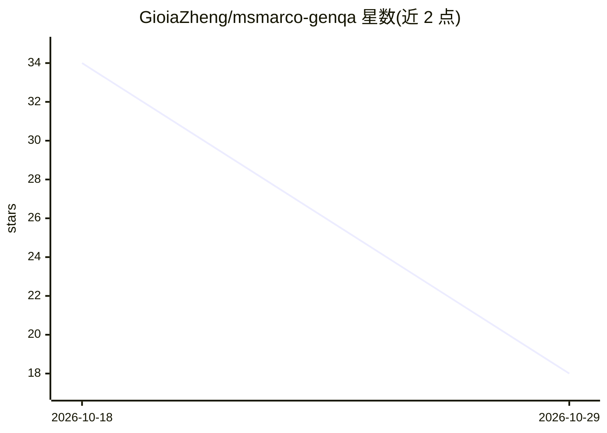

# GioiaZheng/msmarco-genqa

⭐ 18 · Python · MIT · 推送 2026-10-26 · [GitHub](https://github.com/GioiaZheng/msmarco-genqa) · [官网](https://gioiazheng.github.io/projects/msmarco-genqa/) · 个人维护

**MS MARCO 检索增强问答流水线：检索、重排、生成与统计评测的可复现实现**

面向批评测的可复现研究工程仓库：在 MS MARCO dev/small（6,980 查询）上实现 BM25、SBERT+FAISS 稠密检索、交叉编码器重排、T5-small 生成与配对 bootstrap 统计评测，并扩展到 TREC-DL 2019/2020 与 BEIR NFCorpus/SciFact 检索基准。提供配置驱动 runner（run_pipeline.py、rag-eval CLI）、RAG triad 诊断、查询级重排涨跌分析、清单/输出哈希等复现机制与 CI 检查；稠密检索使用文档标注的 5 万 qrels 锚定候选池而非全库稠密首段。适用对象为信息检索/RAG 研究与评测开发者。

## 筛选速览

| 维度 | 判定 | 备注 |
|---|---|---|
| AI 角色 | `ai-ecosystem` | LLM/agent 周边工具 |
| 许可风险 | `permissive` | MIT |
| 部署形态 | `library` | 以包/库形式分发 |
| 模型依赖 | — | README 未给出锁定关系 |
| 硬件要求 | — | 无带数字的原话,不猜 |
| 安装摩擦 | `high` | 编译与系统依赖俱全 |
| 成熟度 | — | 结构信号不足 |

## 能力要点

- BM25→稠密检索→交叉编码器重排→生成→配对 bootstrap 的配置驱动流水线
- TREC-DL 2019/2020 与 BEIR NFCorpus/SciFact 外部检索基准 runner 与适配器
- RAG triad（上下文相关性/接地性/答案相关性）与查询级重排涨跌诊断
- manifest、输出哈希、依赖指纹与 CI 构成的复现证据链

## 适用场景

- 在 MS MARCO 上复现检索-重排-生成实验并做统计显著性检验
- 对 TREC-DL/BEIR 语料运行外部有效性检索基准
- 导出预测迹线做 RAG 可观测性分析

## 场景标签

`RAG` `模型评测` · 领域:评测与运维

## 证据(README 行号)

> L13: This repository is a reproducible research-engineering implementation of an
> L25: **Scope.** The repo is batch-evaluation oriented. It includes experiment
> L72: |Evaluation|Paired-bootstrap confidence intervals, BERTScore proxy checks, grounding audit, RAG triad reporting, qu

## 星数曲线

2026-10-18 34 → 2026-10-29 18（-16）

---
*卡片 v1 · prompt 1.4 · 生成 2026-10-25 · 置信度 high · 依据 README sha `9a717afe546a` · [字段定义](../../DATASET.md)*
