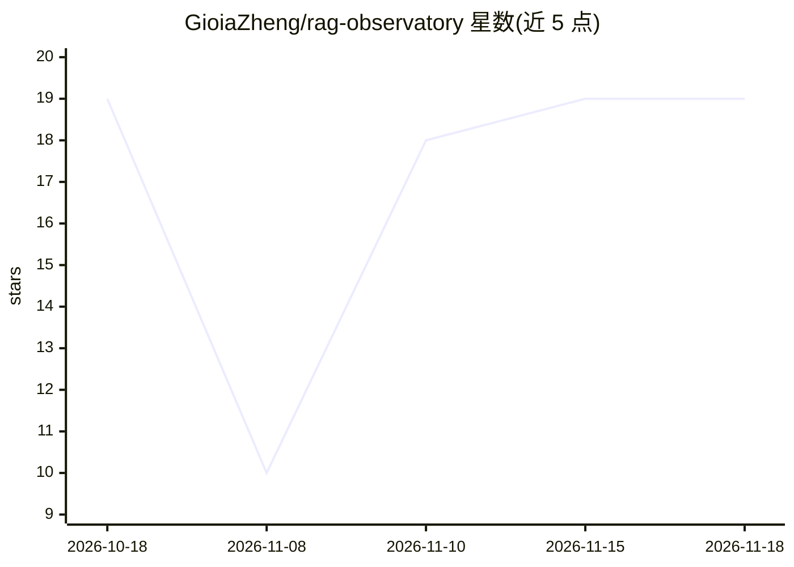

# GioiaZheng/rag-observatory

⭐ 19 · Python · MIT · 推送 2026-10-05 · [GitHub](https://github.com/GioiaZheng/rag-observatory) · [官网](https://gioiazheng.github.io/projects/rag-observatory/) · 个人维护

**RAG 执行轨迹的可观测性与失败分析诊断层**

面向 RAG 实验研究的诊断工具：将执行轨迹（查询、检索、重排、上下文选择、生成、评估信号）转为可检查的诊断产物，区分单分数下看似相同的失败（如证据缺失、上下文选择差、生成不支持答案）。提供轨迹校验、claim 级证据归因、运行前后对比、Markdown/HTML 报告、OTLP/OpenInference 离线导入适配器与一条命令的小型复现工作流。以 Python 包与 CLI（rag-observe）形式提供，需从源码 pip install -e 安装。边界：证据为小型合成轨迹，启发式标签非学习型分类器，接口自声明尚早期。

## 筛选速览

| 维度 | 判定 | 备注 |
|---|---|---|
| AI 角色 | `ai-ecosystem` | LLM/agent 周边工具 |
| 许可风险 | `permissive` | MIT |
| 部署形态 | `library` | 以包/库形式分发 |
| 模型依赖 | — | README 未给出锁定关系 |
| 硬件要求 | — | 无带数字的原话,不猜 |
| 安装摩擦 | `low` | 无编译、无系统依赖或容器化 |
| 成熟度 | `idea` | |

## 能力要点

- 阶段级轨迹契约分离不同来源的失败
- claim 级证据支持与归因视图
- 运行前后对比与失败模式汇总报告
- OTLP/JSON + OpenInference 离线导入适配器

## 适用场景

- 诊断某次 RAG 运行为何失败而总分无法解释
- 对比两次实验配置的失败模式差异
- 对 RAG 轨迹做可复现研究与报告存档

## 场景标签

`LLM 可观测性` `模型评测` · 领域:评测与运维

## 证据(README 行号)

> L7: **Trace-based observability and failure analysis for Retrieval-Augmented Generation.**
> L21: The project is a diagnostic layer around RAG experiments—not another pipeline,
> L29: |Failure diagnosis|Manual and heuristic labels spanning retrieval, evidence use, and generation errors|

## 星数曲线

2026-10-18 19 → 2026-11-18 19（+0）

---
*卡片 v1 · prompt 1.4 · 生成 2026-11-18 · 置信度 mid · 依据 README sha `b5fad0c6339b` · [字段定义](../../DATASET.md)*
