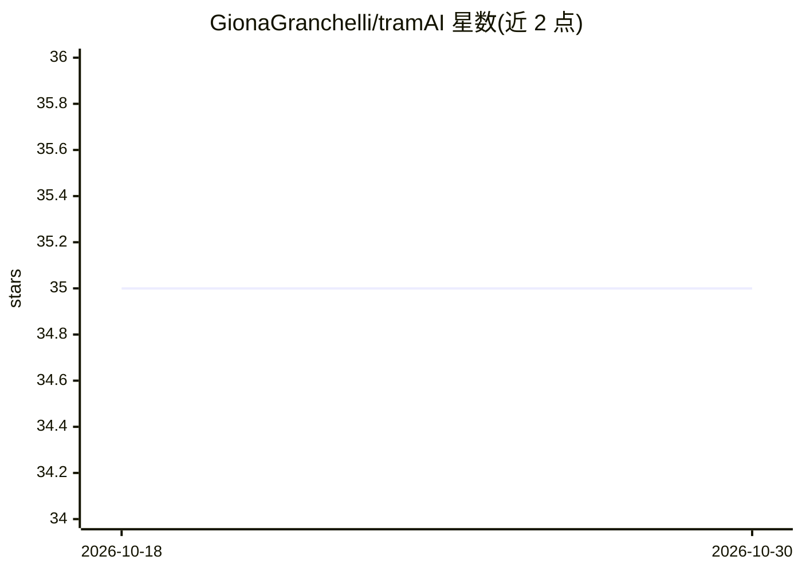

# GionaGranchelli/tramAI

⭐ 35 · Kotlin · Apache-2.0 · 推送 2026-10-29 · [GitHub](https://github.com/GionaGranchelli/tramAI) · [官网](https://tramai.dev) · 个人维护

**Kotlin 优先的 JVM 治理型 AI 工作流运行时**

面向 JVM/Kotlin 开发团队的 AI 工作流运行时：以类型化服务接口替代手工拼装 prompt，在运行时对模型调用、工具授权、人工审批（可挂起/恢复）、数据分类与模型路由执行策略，并输出结构化审计证据。支持独立运行与 Spring Boot 集成，提供 Ollama、OpenAI 兼容 API、Anthropic、Azure OpenAI、Bedrock、Gemini、DeepSeek 的 provider 适配器。0.6.0 发布于 Maven Central，需要 JVM 21+ 与 JDK 21 构建工具链；Sovereign 运行时处于 RC+ 企业验证阶段，稳定 1.0 API 尚未提供。

## 筛选速览

| 维度 | 判定 | 备注 |
|---|---|---|
| AI 角色 | `ai-ecosystem` | LLM/agent 周边工具 |
| 许可风险 | `permissive` | Apache-2.0 |
| 部署形态 | `None` |  |
| 模型依赖 | local-ok | 支持本地模型 |
| 硬件要求 | — | 无带数字的原话,不猜 |
| 安装摩擦 | `medium` | 含编译或系统依赖之一 |
| 成熟度 | `idea` | |

## 能力要点

- 类型化 AI 契约：JVM 接口、结构化输出、schema 生成与确定性测试
- 运行时治理：策略在模型/工具/响应前执行，未知工具与模型默认拒绝
- 人工审批生命周期：挂起、恢复、幂等与重放安全
- 审计序列化与防篡改证据记录（配置时生效）

## 适用场景

- 构建需要人工审批门控的 AI 业务流程
- 按数据分类与信任策略控制模型路由
- 为敏感 AI 调用留存可导出的审计证据
- 在 Spring Boot 应用中引入治理型 AI 工作流

## 场景标签

`工作流自动化` · 领域:效率与自动化

## 证据(README 行号)

> L8: TramAI is a **Kotlin-first JVM runtime for governed AI workflows**, combining typed AI contracts with runtime policy
> L126: - **Core runtime** — typed services, engine, structured output, testing

## 星数曲线

2026-10-18 35 → 2026-10-30 35（+0）

---
*卡片 v1 · prompt 1.4 · 生成 2026-10-25 · 置信度 high · 依据 README sha `1bb6016e8dcf` · [字段定义](../../DATASET.md)*
