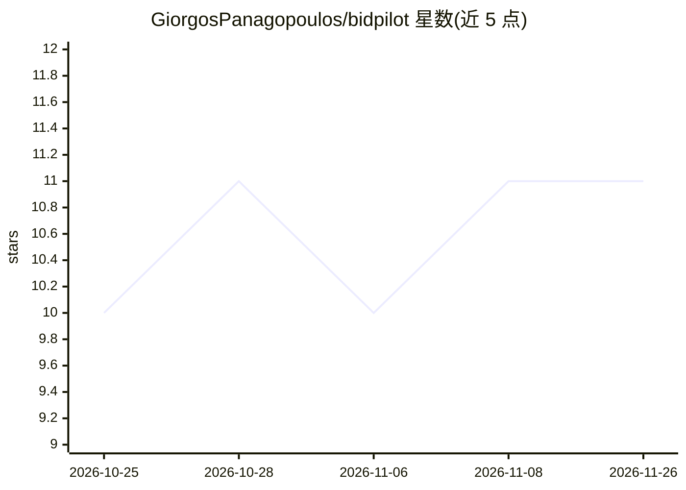

# GiorgosPanagopoulos/bidpilot

⭐ 11 · Python · MIT · 推送 2026-11-22 · [GitHub](https://github.com/GiorgosPanagopoulos/bidpilot) · 个人维护

**供应商端标书智能后端：语义匹配、资格审查与引用式标书起草**

面向供应商的招标情报后端：从 TED 公共采购平台摄取招标公告，经两阶段混合引擎（语义检索+规则重排）匹配企业画像，再用 YAML 声明式引擎筛查资格条件；ReAct agent 读取招标 PDF、抽取结构化需求、分析能力差距，并逐节生成带引用的标书草稿。另接入 ΔΙΑΥΓΕΙΑ 中标数据，提供 CPV 历史价格、供应商中标率与趋势分析。所有草稿状态强制 needs_review，无自动提交路径。架构上采用 ContextVar 多租户、Mongo 审计日志、版本化提示词热重载与完整 CI。

## 筛选速览

| 维度 | 判定 | 备注 |
|---|---|---|
| AI 角色 | `ai-native` | 本体是模型或模型工具 |
| 许可风险 | `permissive` | MIT |
| 部署形态 | `library` | 以包/库形式分发 |
| 模型依赖 | locked-api |  |
| 硬件要求 | — | 无带数字的原话,不猜 |
| 安装摩擦 | `low` | 无编译、无系统依赖或容器化 |
| 成熟度 | — | 结构信号不足 |

## 能力要点

- 两阶段混合匹配：语义检索 top-k 后按 CPV/NUTS/预算规则重排，每个结果携带可解释 reasons[]
- ReAct agent 生成带 [Locator] 内联引用的标书草稿，self_check 工具校验强制条款覆盖
- 声明式资格引擎：YAML 规则运行时热重载，区分硬性拦截与软性警告
- 分析层：CPV 价格分位数、供应商 win_share、月/季/年趋势序列

## 适用场景

- 供应商从 TED 海量公告中筛选与自身资质匹配的招标项目
- 起草标书技术方案章节，并保留人工审核关口
- 分析历史中标价格与竞争对手中标率辅助投标决策

## 场景标签

`RAG` `语义搜索` `AI 写作` · 领域:内容生成

## 证据(README 行号)

> L24: BidPilot is a supplier-side tender intelligence backend. It ingests public tenders from TED (Tenders Electronic Dai
> L39: |RAG Bid Drafting|ReAct agent (LangChain `create_react_agent` + `AgentExecutor`) reads an ingested tender PDF, extr
> L74: |Anthropic|**Anthropic Claude**|LLM for requirement extraction, section drafting, and self-check (model configurabl

## 星数曲线

2026-10-25 10 → 2026-11-26 11（+1）

---
*卡片 v1 · prompt 1.4 · 生成 2026-11-19 · 置信度 high · 依据 README sha `3693fc74a3c0` · [字段定义](../../DATASET.md)*
