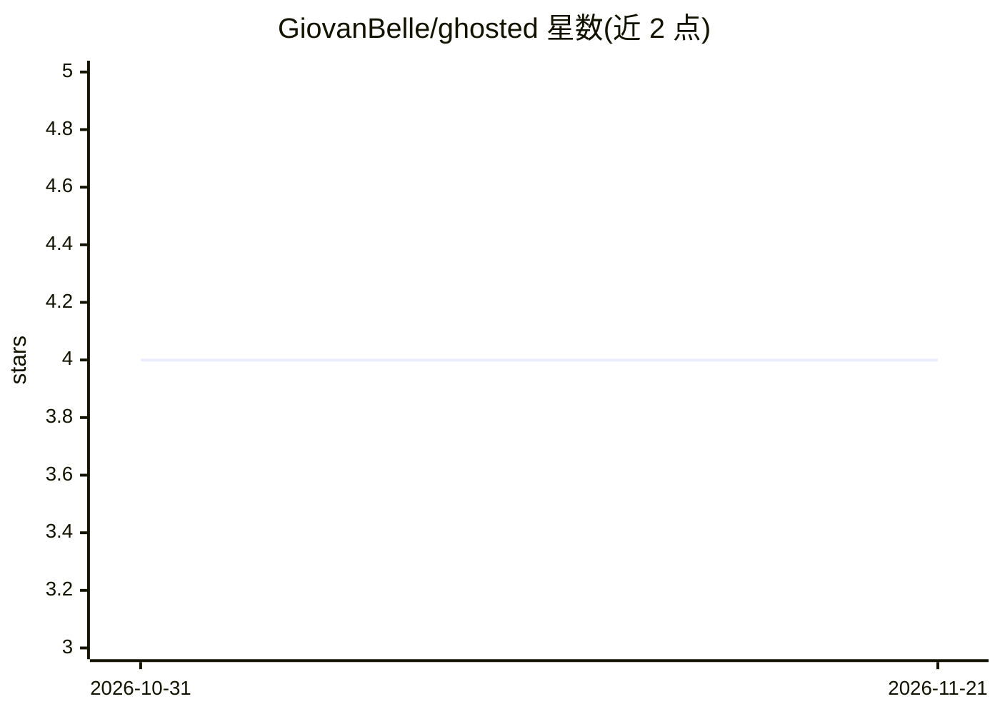

# GiovanBelle/ghosted

⭐ 4 · JavaScript · Apache-2.0 · 推送 2026-11-03 · [GitHub](https://github.com/GiovanBelle/ghosted) · [官网](https://giovanbelle.github.io/ghosted/) · 个人维护

**Claude Code 插件：任务切换时释放上下文以降低费用**

以 Claude Code 插件形式提供，通过 UserPromptSubmit hook 检测任务切换：小上下文时用 Haiku 判定每个 prompt 属于 same/related/new 三类，related 生成交接笔记后 /clear，new 直接清空并携最多 5 条事实启动；旧对话先归档，/resume 可恢复。另提供精简回答、缓存保温（订阅 1 小时到期前重发会话）、本地统计面板与 30 天归档检索。出错时失败放行，prompt 照常通过。依赖 Node.js 与 claude CLI；macOS/Linux 的保温和终端桥接需 python3。

## 筛选速览

| 维度 | 判定 | 备注 |
|---|---|---|
| AI 角色 | `ai-ecosystem` | LLM/agent 周边工具 |
| 许可风险 | `permissive` | Apache-2.0 |
| 部署形态 | `None` |  |
| 模型依赖 | — | README 未给出锁定关系 |
| 硬件要求 | — | 无带数字的原话,不猜 |
| 安装摩擦 | `low` | 无编译、无系统依赖或容器化 |
| 成熟度 | — | 结构信号不足 |

## 能力要点

- Haiku 判定器将 prompt 分为 same/related/new 并自动清空上下文
- 缓存保温：在 prompt cache 到期前通过隐藏副本会话重发
- 本地仪表盘 /ghosted-stats 显示切换次数、丢弃 token 与估算节省
- 旧对话归档 30 天，/ghosted-recall 关键词检索

## 适用场景

- 在同一个 Claude Code 会话中频繁切换任务以降低 token 费用
- 缓存过期后回到大对话时避免整段上下文重新计费写入
- 需要恢复被误清空的历史对话时用 /resume 找回

## 场景标签

 · 领域:LLM 工具链/成本优化

## 证据(README 行号)

> L4:  A Claude Code plugin that frees the context when you switch task, then starts your task for you.
> L97: your prompt ──► UserPromptSubmit hook

## 星数曲线

2026-10-31 4 → 2026-11-21 4（+0）

---
*卡片 v1 · prompt 1.4 · 生成 2026-11-21 · 置信度 high · 依据 README sha `9799268195a4` · [字段定义](../../DATASET.md)*
