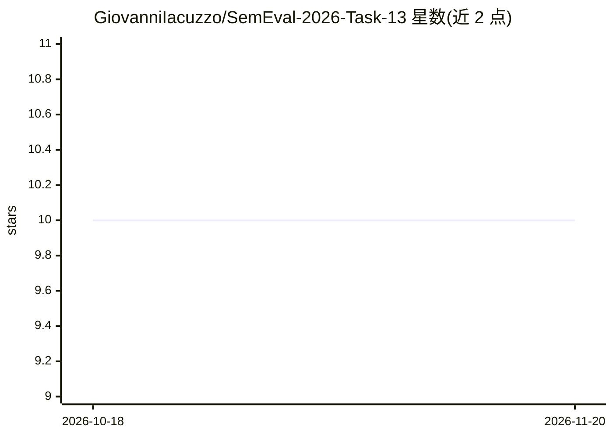

# GiovanniIacuzzo/SemEval-2026-Task-13

⭐ 10 · Python · 推送 2026-01-17 · [GitHub](https://github.com/GiovanniIacuzzo/SemEval-2026-Task-13) · 个人维护 · 中文 README

**SemEval-2026 任务13 参赛方案：检测与归因 LLM 生成代码**

面向 SemEval-2026 Task 13 竞赛的统一解决方案，以模块化框架覆盖三个子任务：A（区分代码是人类还是机器生成的二分类）、B（识别具体作者模型的多分类）、C（混合来源分析，含修改/重构场景）。三个子任务共享执行环境与集中式数据处理管道，数据以 parquet 格式按任务分目录存放，环境通过 Conda 脚本一键搭建，数据集从 Kaggle 下载。需要 NVIDIA GPU 用于训练，Linux/macOS 或 WSL 运行。

## 筛选速览

| 维度 | 判定 | 备注 |
|---|---|---|
| AI 角色 | `ai-native` | 本体是模型或模型工具 |
| 许可风险 | `none` | — |
| 部署形态 | `library` | 以包/库形式分发 |
| 模型依赖 | — | README 未给出锁定关系 |
| 硬件要求 | — | 无带数字的原话,不猜 |
| 安装摩擦 | `low` | 无编译、无系统依赖或容器化 |
| 成熟度 | — | 结构信号不足 |

## 能力要点

- 覆盖竞赛三个子任务：检测、作者归因、混合来源分析
- 三子任务共享集中式管道与 Conda 环境，prepare.sh 一键搭建
- 数据集按 parquet 分任务组织，从 Kaggle 自动下载

## 适用场景

- 复现或改进 SemEval-2026 Task 13 的参赛方案
- 训练模型区分 LLM 生成代码与人类代码
- 分析人类与 AI 混合来源的代码及重构修改

## 场景标签

`代码审查` `科研工具` · 领域:编码与开发

## 证据(README 行号)

> L7: This repository contains the unified solution for **SemEval-2026 Task 13**, an international competition focused on 
> L17: |**Subtask A**|**Machine-Generated Code Detection**|Distinguish whether code is written by a Human or a Machine.|*B
> L19: |**Subtask C**|**Mixed-Source Analysis**|Analyze modifications, refactoring, and hybrid Human/AI code.|*Regression 

## 星数曲线

2026-10-18 10 → 2026-11-20 10（+0）

---
*卡片 v1 · prompt 1.4 · 生成 2026-11-20 · 置信度 mid · 依据 README sha `f8993f487d76` · [字段定义](../../DATASET.md)*
