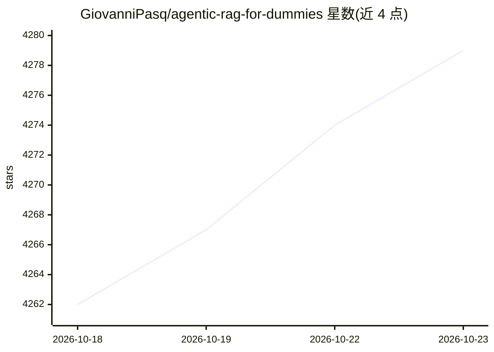

# GiovanniPasq/agentic-rag-for-dummies

⭐ 4,279 · Jupyter Notebook · MIT · 推送 2026-10-17 · [GitHub](https://github.com/GiovanniPasq/agentic-rag-for-dummies) · 个人维护

**面向学习者的 Agentic RAG 教学项目：用 LangGraph 搭建多智能体检索问答**

基于 LangGraph 的模块化 Agentic RAG 教学与参考实现：文档按 Parent/Child 双层分块索引到 Qdrant（混合检索），查询经对话摘要、改写澄清（含人工介入）后由并行 agent 子图分头检索、自纠错、上下文压缩，再聚合生成回答。提供交互式 notebook（可 Colab 打开）与可扩展工程两条使用路径；可运行应用默认 Ollama 本地模型，示例覆盖 OpenAI、Anthropic、Google；另含 Langfuse 观测与 RAGAS 评测 notebook。限制：建议 8B+ 模型以保证工具调用可靠性。

## 筛选速览

| 维度 | 判定 | 备注 |
|---|---|---|
| AI 角色 | `ai-knowledge` | 知识聚合/清单类 |
| 许可风险 | `permissive` | MIT |
| 部署形态 | `library` | 以包/库形式分发 |
| 模型依赖 | local-ok | 支持本地模型 |
| 硬件要求 | — | 无带数字的原话,不猜 |
| 安装摩擦 | `low` | 无编译、无系统依赖或容器化 |
| 成熟度 | — | 结构信号不足 |

## 能力要点

- Parent/Child 层级索引 + Qdrant 混合检索
- 多 agent Map-Reduce 并行子查询与自纠错、上下文压缩
- 默认 Ollama 本地运行，可切换 OpenAI/Anthropic/Google
- 配套 RAGAS 评测与 Langfuse 观测 notebook

## 适用场景

- 跟随 notebook 学习 Agentic RAG 的构建流程
- 以模块化工程为模板扩展自己的 RAG 应用
- 本地 Ollama 模型上对自有 PDF 文档做问答

## 场景标签

`RAG` `多智能体` `教程课程` · 领域:Agent 开发

## 证据(README 行号)

> L36: This repository demonstrates how to build an **Agentic RAG (Retrieval-Augmented Generation)** system using LangGrap
> L54: **1️⃣ Learning Path: Interactive Notebook**
> L60: Flexible architecture where each component can be independently adapted — LLM provider, embedding model, PDF conver

## 星数曲线

2026-10-18 4,262 → 2026-10-23 4,279（+17）

---
*卡片 v1 · prompt 1.4 · 生成 2026-10-21 · 置信度 mid · 依据 README sha `0a72873f2471` · [字段定义](../../DATASET.md)*
