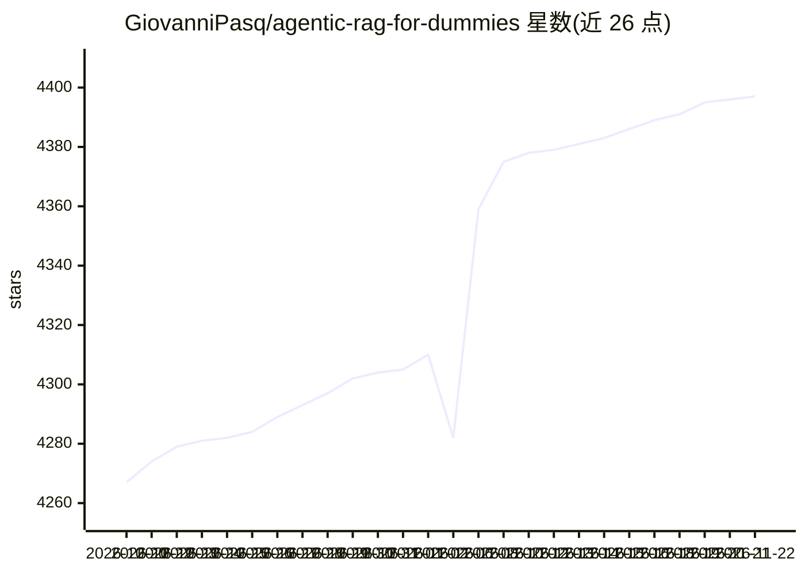

# GiovanniPasq/agentic-rag-for-dummies

⭐ 4,397 · Jupyter Notebook · MIT · 推送 2026-11-10 · [GitHub](https://github.com/GiovanniPasq/agentic-rag-for-dummies) · 个人维护

**用 LangGraph 搭建模块化 Agentic RAG 的教程仓库**

以教程加可运行项目两种形式展示如何用 LangGraph 构建模块化的 Agentic RAG 系统：文档按父/子分块做层级索引，查询经会话摘要、改写、澄清（human-in-the-loop）后由多 agent 并行检索并聚合回答，带自我纠错与上下文压缩，用 Langfuse 做观测、RAGAS 做评估。提供交互式笔记本学习路径和可独立替换组件（LLM、嵌入、PDF 转换器）的模块化工程，运行应用默认走 Ollama 本地模型，建议 8B+ 模型以保证工具调用。

## 筛选速览

| 维度 | 判定 | 备注 |
|---|---|---|
| AI 角色 | `ai-knowledge` | 知识聚合/清单类 |
| 许可风险 | `permissive` | MIT |
| 部署形态 | `library` | 以包/库形式分发 |
| 模型依赖 | local-ok | 支持本地模型 |
| 硬件要求 | — | 无带数字的原话,不猜 |
| 安装摩擦 | `low` | 无编译、无系统依赖或容器化 |
| 成熟度 | — | 结构信号不足 |

## 能力要点

- 父/子分块的层级索引：小块检索、大块提供上下文
- 四阶段查询流程：会话摘要→改写→澄清→多 agent Map-Reduce 检索
- 自我纠错、上下文压缩与检索预算耗尽时的 fallback 回答
- Langfuse 观测与 RAGAS 检索/答案质量评估

## 适用场景

- 从零学习如何用 LangGraph 搭建 Agentic RAG
- 拿模块化架构改造成自己的文档问答应用
- 给本地 Ollama 模型配一套带澄清与并行的检索流水线
- 用 RAGAS 评估 RAG 系统的检索与回答质量

## 场景标签

`RAG` `教程课程` · 领域:知识与检索

## 证据(README 行号)

> L36: This repository demonstrates how to build an **Agentic RAG (Retrieval-Augmented Generation)** system using LangGrap
> L56: Step-by-step tutorial perfect for understanding core concepts. Start here if you're new to Agentic RAG or want to e
> L60: Flexible architecture where each component can be independently adapted — LLM provider, embedding model, PDF conver

## 星数曲线

2026-10-20 4,267 → 2026-11-22 4,397（+130）

---
*卡片 v1 · prompt 1.4 · 生成 2026-11-22 · 置信度 mid · 依据 README sha `c689227204ab` · [字段定义](../../DATASET.md)*
