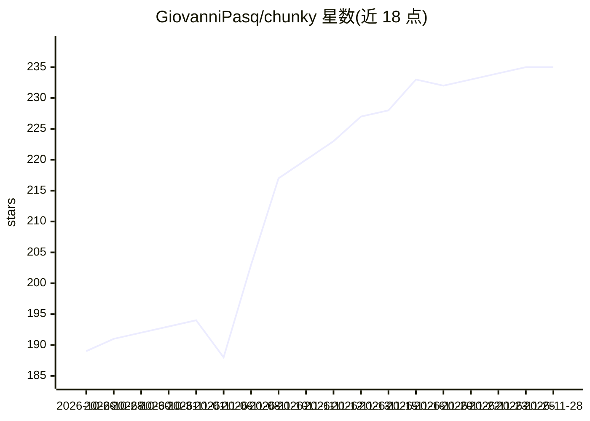

# GiovanniPasq/chunky

⭐ 235 · Python · MIT · 推送 2026-11-09 · [GitHub](https://github.com/GiovanniPasq/chunky) · 个人维护

**本地开源的 RAG 文档准备可视化工作台**

Chunky 是一个本地运行的文档审阅工作台：在文档进入向量库之前，检查 PDF 到 Markdown 的转换结果、清理转换噪声、在真实文档上对比多种分块策略并审阅生成的 chunks。支持 PyMuPDF、Docling、MarkItDown、LiteParse、VLM 与 Cloud API 六种转换器，集成 LangChain、Chonkie、Docling 三类分块库，可用本地或远程 LLM 做 Markdown 修正与 chunk 增强（标题、摘要、关键词、检索问题），并提供批处理、导出与插件式后端扩展。

## 筛选速览

| 维度 | 判定 | 备注 |
|---|---|---|
| AI 角色 | `ai-ecosystem` | LLM/agent 周边工具 |
| 许可风险 | `permissive` | MIT |
| 部署形态 | `self-host` | docker 或自建部署 |
| 模型依赖 | local-ok | 支持本地模型 |
| 硬件要求 | — | 无带数字的原话,不猜 |
| 安装摩擦 | `low` | 无编译、无系统依赖或容器化 |
| 成熟度 | — | 结构信号不足 |

## 能力要点

- 六种 PDF 转 Markdown 引擎可在 UI 中切换对比
- 三种分块库、十余种策略的可配置对比与版本保存
- chunk 增强：生成标题、摘要、关键词与检索问题
- 通过 capabilities API 动态发现转换器与分块器的插件式扩展

## 适用场景

- 在索引前检查 PDF 转换出的表格与版式是否损坏
- 在同一份文档上对比不同分块策略的切分效果
- 为 chunks 批量生成上下文标题、摘要与检索问题
- 编写自定义转换器或分块器接入工作台

## 场景标签

`RAG` `文档解析` · 领域:知识与检索

## 证据(README 行号)

> L7:  A local, open-source workspace to inspect PDF conversion, refine Markdown, compare chunking strategies, and review 
> L23: Broken tables, scrambled layouts, noisy Markdown, and poor chunk boundaries can undermine retrieval. Chunky makes t
> L38: |✂️ **Chunking strategy comparison**|Test LangChain, Chonkie, and Docling splitters with configurable size and over

## 星数曲线

2026-10-26 189 → 2026-11-28 235（+46）

---
*卡片 v1 · prompt 1.4 · 生成 2026-11-25 · 置信度 high · 依据 README sha `9c8cda401ded` · [字段定义](../../DATASET.md)*
