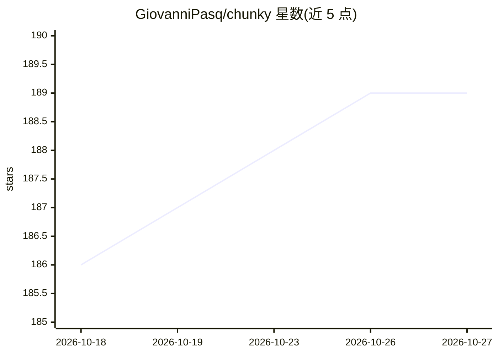

# GiovanniPasq/chunky

⭐ 189 · Python · MIT · 推送 2026-10-17 · [GitHub](https://github.com/GiovanniPasq/chunky) · 个人维护

**面向 RAG 的本地文档处理工作台：PDF 转 Markdown、清洗、分块与元数据增强**

本地运行的开源工作区，覆盖 RAG 前置流程：六种 PDF 转 Markdown 引擎（PyMuPDF/Docling/MarkItDown/LiteParse/VLM/Cloud API）、确定性清理加 LLM 修正的 Markdown 增强、LangChain/Chonkie/Docling 三家分块策略可视化对比、以及基于 LLM 的 chunk 元数据生成（标题/摘要/关键词/可回答问题）。转换器与分块器通过注册表插件化扩展。支持本地源码启动与 Docker 部署；VLM 转换默认对接本地 Ollama，无 GPU 时 Docling 与 Ollama 速度显著下降。

## 筛选速览

| 维度 | 判定 | 备注 |
|---|---|---|
| AI 角色 | `ai-ecosystem` | LLM/agent 周边工具 |
| 许可风险 | `permissive` | MIT |
| 部署形态 | `self-host` | docker 或自建部署 |
| 模型依赖 | local-ok | 支持本地模型 |
| 硬件要求 | — | 无带数字的原话,不猜 |
| 安装摩擦 | `low` | 无编译、无系统依赖或容器化 |
| 成熟度 | — | 结构信号不足 |

## 能力要点

- 六种 PDF 转 Markdown 转换引擎可在 UI 中切换
- LangChain/Chonkie/Docling 分块策略在真实文档上对比
- 两级 LLM 增强：Markdown 清洗修正与 chunk 元数据生成（标题/摘要/关键词/问题）
- 注册表机制下新增转换器或分块策略无需改前端

## 适用场景

- 把 PDF 转成干净 Markdown 再入向量库
- 在索引前检查并修复分块质量
- 为不同文档选合适的分块策略
- 批量为 chunk 生成标题、摘要与检索问题

## 场景标签

`文档解析` `RAG` · 领域:知识与检索

## 证据(README 行号)

> L11: Chunky is a local, open-source workspace for preparing documents for Retrieval-Augmented Generation (RAG). It combi
> L26: |✂️ **Chunking strategy comparison**|Test LangChain, Chonkie, and Docling splitters with configurable size and over

## 星数曲线

2026-10-18 186 → 2026-10-27 189（+3）

---
*卡片 v1 · prompt 1.4 · 生成 2026-10-22 · 置信度 high · 依据 README sha `ec47c11fc12e` · [字段定义](../../DATASET.md)*
