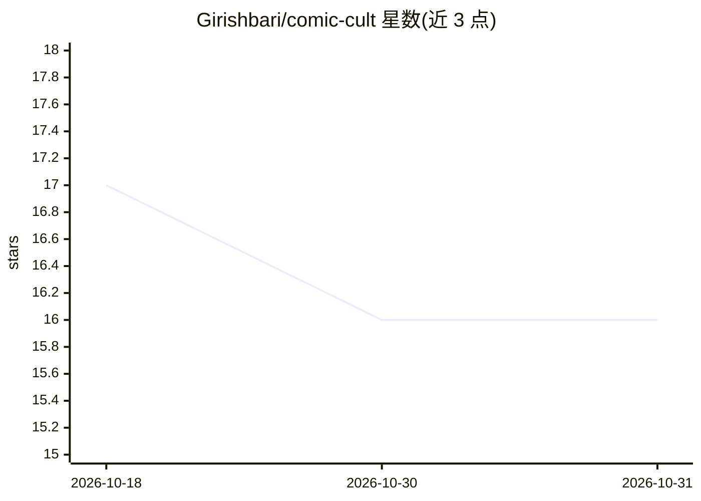

# Girishbari/comic-cult

⭐ 16 · JavaScript · 推送 2026-08-30 · [GitHub](https://github.com/Girishbari/comic-cult) · 个人维护

**把故事文本转成带对话的漫画 PDF 并邮件送达的 Web 应用**

基于 Next.js 14 前端与 Express 后端的漫画生成 Web 应用：用 Gemini AI 从故事生成对话，调用 Stability AI / DreamStudio API 生成漫画图像，再经 Canvas 将对话叠加到图像上，最终产出漫画 PDF 并通过 Nodemailer 发送到用户邮箱。集成 Flagsmith 特性开关管理功能启停，环境变量中需配置 Gemini、DreamStudio、Flagsmith 与邮箱的 API key。运行方式为 git clone 源码后 npm 安装依赖、分别启动前后端。

## 筛选速览

| 维度 | 判定 | 备注 |
|---|---|---|
| AI 角色 | `ai-native` | 本体是模型或模型工具 |
| 许可风险 | `none` | — |
| 部署形态 | `library` | 以包/库形式分发 |
| 模型依赖 | — | README 未给出锁定关系 |
| 硬件要求 | — | 无带数字的原话,不猜 |
| 安装摩擦 | `low` | 无编译、无系统依赖或容器化 |
| 成熟度 | — | 结构信号不足 |

## 能力要点

- Gemini 生成故事对话，Stability AI/DreamStudio API 生成漫画图像
- Canvas 将对话叠加到图像并合成漫画 PDF
- Nodemailer 邮件投递成品 PDF
- Flagsmith 特性开关控制功能启停

## 适用场景

- 把写好的故事快速变成带对话的漫画并收到 PDF
- 在 Web 界面上生成故事可视化漫画内容

## 场景标签

`图像生成` · 领域:内容生成

## 证据(README 行号)

> L9: Transform your stories into captivating comic art with dialogue effortlessly! Our project harnesses the power of Gem
> L22:  : Leveraging stability AI and DreamStudio API keys, Comic Art Generation process is infused with stability and cre
> L54: - Gemini AI - It has api which could be use ful to make prompt and get output

## 星数曲线

2026-10-18 17 → 2026-10-31 16（-1）

---
*卡片 v1 · prompt 1.4 · 生成 2026-10-30 · 置信度 mid · 依据 README sha `c884233b8f02` · [字段定义](../../DATASET.md)*
