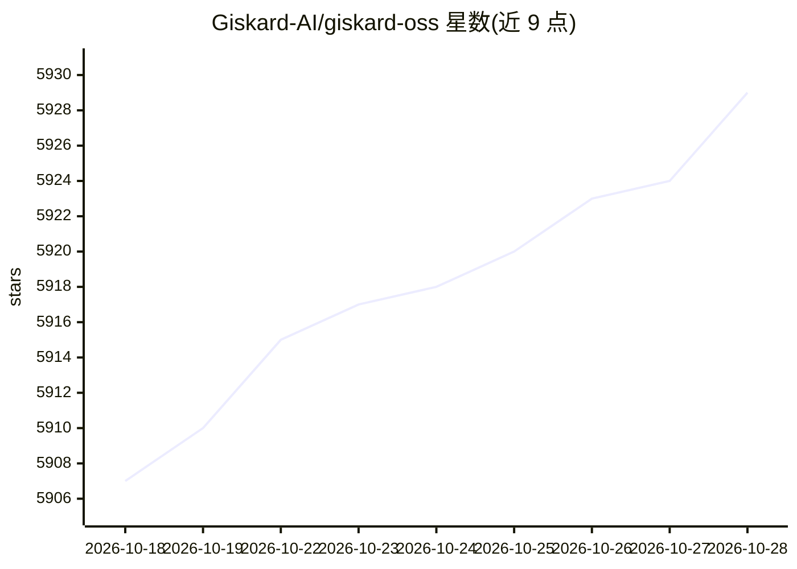

# Giskard-AI/giskard-oss

⭐ 5,929 · Python · Apache-2.0 · 推送 2026-10-27 · [GitHub](https://github.com/Giskard-AI/giskard-oss) · [官网](https://docs.giskard.ai) · 组织维护

**面向 LLM Agent 的开源评测与红队测试库**

Giskard v3 是用于测试与评估 AI agent 系统的 Python 库，由两个稳定包构成：giskard-checks 提供场景化评测 API 与内置检查（含 LLM-as-judge、Groundedness、Conformity），giskard-scan 提供漏洞扫描与红队测试（提示注入、越狱、有害内容、OWASP LLM Top-10 类别）及知识库质量评估。底层依赖 giskard-core/giskard-llm/giskard-agents 自动安装。需 Python 3.12+，LLM 裁判与生成器需安装 provider extra 并配置 API key（默认 openai/gpt-4o-mini）。v2 不再积极维护，表格/ML 模型的自动扫描仍为 v2 专属。

## 筛选速览

| 维度 | 判定 | 备注 |
|---|---|---|
| AI 角色 | `ai-ecosystem` | LLM/agent 周边工具 |
| 许可风险 | `permissive` | Apache-2.0 |
| 部署形态 | `library` | 以包/库形式分发 |
| 模型依赖 | — | README 未给出锁定关系 |
| 硬件要求 | — | 无带数字的原话,不猜 |
| 安装摩擦 | `low` | 无编译、无系统依赖或容器化 |
| 成熟度 | — | 结构信号不足 |

## 能力要点

- 场景化评测 API：Target/Scenario/Check/Suite，支持多轮对话与非确定性输出
- giskard-scan 红队扫描：自动生成对抗测试，覆盖提示注入、有害内容等
- RAG 质量评估（quality_scan，v2 RAGET 的继任者）
- 模块化包结构，各包只携带所需依赖，支持同步/异步

## 适用场景

- 为我的 LLM agent 编写回归测试与安全规则检查
- 红队测试 agent 的提示注入与越狱漏洞
- 评估 RAG 回答是否基于检索到的上下文
- 评估 ML 模型（包装为 target 后测试）

## 场景标签

`模型评测` `网络安全` · 领域:评测与运维

## 证据(README 行号)

> L4:  Evals, Red Teaming and Test Generation for Agentic Systems
> L42: Giskard is an open-source Python library for **testing and evaluating agentic systems**. The v3 architecture is a m

## 星数曲线

2026-10-18 5,907 → 2026-10-28 5,929（+22）

---
*卡片 v1 · prompt 1.4 · 生成 2026-10-20 · 置信度 high · 依据 README sha `4ad55d099007` · [字段定义](../../DATASET.md)*
