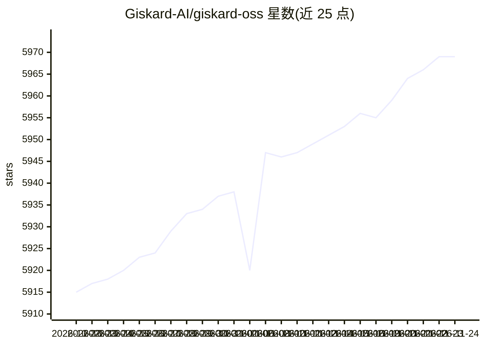

# Giskard-AI/giskard-oss

⭐ 5,969 · Python · Apache-2.0 · 推送 2026-11-22 · [GitHub](https://github.com/Giskard-AI/giskard-oss) · [官网](https://docs.giskard.ai) · 组织维护

**面向开发者的 LLM Agent 评测与红队测试库**

开源 Python 库，用于测试与评估 agentic 系统，v3 重写为模块化包集：giskard-checks 提供场景 API、内置断言与 LLM-as-judge 评估，giskard-scan 提供 Agent 漏洞扫描与 RAG/质量评估，覆盖提示注入、越狱、有害内容、刻板印象等 OWASP LLM Top-10 威胁类别，可从自然语言描述自动生成对抗测试集；底层由 giskard-core/llm/agents 三个基础库支撑。需 Python 3.12+，LLM judge 与扫描生成器需安装 provider extra 并配置 API key。v2 仍可用但不再积极维护，v2 的表格模型自动扫描与 Giskard Hub 不计划迁移到 v3。

## 筛选速览

| 维度 | 判定 | 备注 |
|---|---|---|
| AI 角色 | `ai-ecosystem` | LLM/agent 周边工具 |
| 许可风险 | `permissive` | Apache-2.0 |
| 部署形态 | `library` | 以包/库形式分发 |
| 模型依赖 | — | README 未给出锁定关系 |
| 硬件要求 | — | 无带数字的原话,不猜 |
| 安装摩擦 | `low` | 无编译、无系统依赖或容器化 |
| 成熟度 | — | 结构信号不足 |

## 能力要点

- giskard-checks：场景 API + LLM-as-judge（Groundedness/Conformity/LLMJudge），针对非确定性输出
- giskard-scan：从自然语言描述自动生成红队对抗测试集，含内置提示注入 payload 数据集
- 模块化架构：checks/scan 两个稳定包 + core/llm/agents 三个基础库
- v2 Scan 与 RAGET 的后继者以 vulnerability_scan 与 quality_scan 内置于 giskard-scan

## 适用场景

- 上线前对多轮 Agent 做回归与安全红队测试
- 校验 RAG 回答是否基于检索到的上下文
- 按内容政策强制执行输出安全规则
- 对 ML 模型包装为 target 后做性能/偏差评估（v2 路径）

## 场景标签

`模型评测` `网络安全` · 领域:评测与运维

## 证据(README 行号)

> L42: Giskard is an open-source Python library for **testing and evaluating agentic systems**. The v3 architecture is a m
> L46: |✅ Stable|`giskard-checks`|Testing & evaluation — scenario API, built-in checks, LLM-as-judge|
> L57: **Giskard Checks** is a lightweight library for creating evaluations (evals) that test LLM-based systems — from sim

## 星数曲线

2026-10-22 5,915 → 2026-11-24 5,969（+54）

---
*卡片 v1 · prompt 1.4 · 生成 2026-11-22 · 置信度 high · 依据 README sha `8155bf371818` · [字段定义](../../DATASET.md)*
