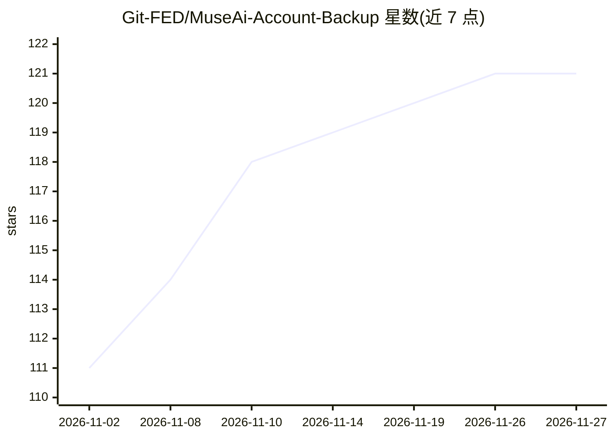

# Git-FED/MuseAi-Account-Backup

⭐ 121 · HTML · MIT · 推送 2026-10-06 · [GitHub](https://github.com/Git-FED/MuseAi-Account-Backup) · [官网](https://git-fed.github.io/MuseAi-Account-Backup/) · 个人维护

**AI agent 账号锁定后的业务连续性备份工具包（模板+离线工作表）**

面向依赖 AI agent 的业务所有者的厂商中立连续性工具包：提供凭据/访问清单模板、业务连续性与应急预案模板、入职/离职/暴露响应检查清单，以及一个仅记录元数据的静态离线 worksheet 站点（数据存浏览器 localStorage，无服务器/分析/登录）。采用三层备份模型：清单、密钥存储（外部加密保险库）、恢复证据。明确声明非官方支持、非密码管理器、不自动运行 prompt，禁止存放任何真实密钥。附 JSON schema、内容验证规则（user-reported/verified/unknown 标注）与 Node 自动化检查。

## 筛选速览

| 维度 | 判定 | 备注 |
|---|---|---|
| AI 角色 | `ai-knowledge` | 知识聚合/清单类 |
| 许可风险 | `permissive` | MIT |
| 部署形态 | `None` |  |
| 模型依赖 | — | README 未给出锁定关系 |
| 硬件要求 | — | 无带数字的原话,不猜 |
| 安装摩擦 | `low` | 无编译、无系统依赖或容器化 |
| 成熟度 | — | 结构信号不足 |

## 能力要点

- 凭据与访问清单、业务连续性、暴露响应等填空式模板
- 离线静态 worksheet 站点，仅存非密钥元数据于 localStorage
- 三层备份模型：清单/外部密钥库/恢复证据
- Node 自动化检查（导航、数据加载、不安全凭据字段）

## 适用场景

- AI agent 账号被锁后仍能独立访问所有凭据与配置
- 企业为依赖 AI agent 的流程制定连续性与回退计划
- 记录服务恢复流程、轮换指引与最后验证日期

## 场景标签

 · 领域:IT 运维/业务连续性

## 证据(README 行号)

> L5: A vendor-independent continuity kit for backing up, rotating, and recovering information used by AI agents—without s
> L13: - A credential and access inventory template
> L16: - A static, offline-first worksheet site for recording **metadata only**

## 星数曲线

2026-11-02 111 → 2026-11-27 121（+10）

---
*卡片 v1 · prompt 1.4 · 生成 2026-11-17 · 置信度 mid · 依据 README sha `ec19084f8186` · [字段定义](../../DATASET.md)*
