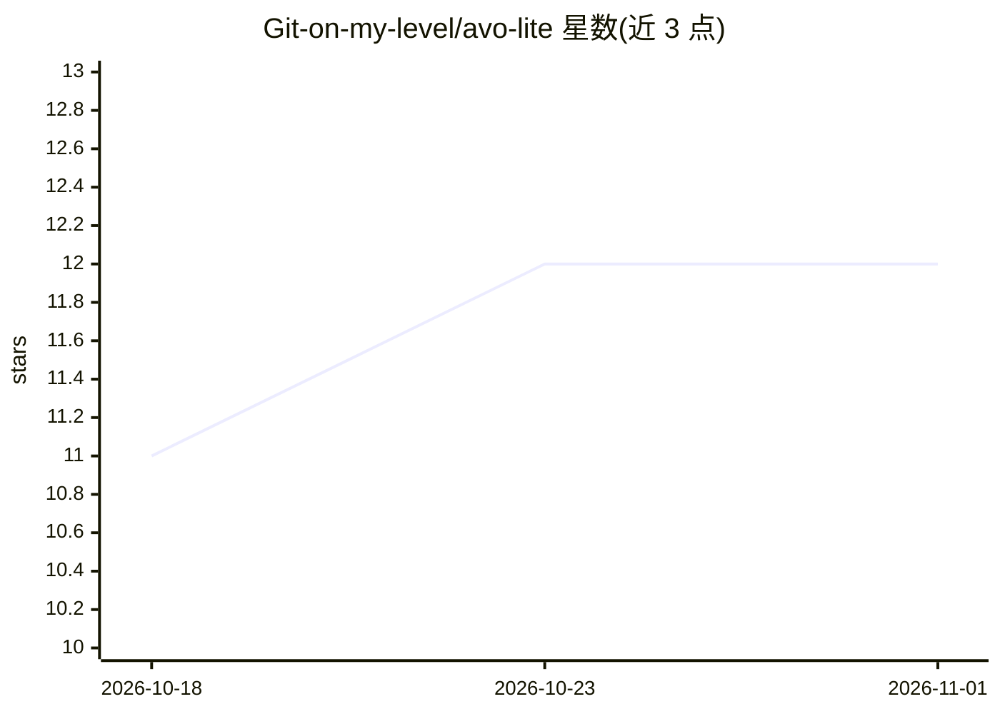

# Git-on-my-level/avo-lite

⭐ 12 · Python · MIT · 推送 2026-09-26 · [GitHub](https://github.com/Git-on-my-level/avo-lite) · 个人维护

**让任意 agent 自主迭代改进代码的优化循环框架**

面向可自动评估任务的 agent 无关优化循环：每轮给 agent 一个一次性 Git worktree，agent 修改后由 scorer 评估，可选对抗验证者质疑候选，通过即成为下一 Git 提交，否则丢弃但结果记入只追加账本供后续尝试参考。核心为单个无依赖 Python 文件加两个启动脚本，agent/scorer/verifier/supervisor 均以普通可执行命令接入，无插件 SDK。不沙箱恶意 agent，不防御奖励攻击；停滞检测不依赖 LLM。供开发者搭建自动改进循环。

## 筛选速览

| 维度 | 判定 | 备注 |
|---|---|---|
| AI 角色 | `ai-ecosystem` | LLM/agent 周边工具 |
| 许可风险 | `permissive` | MIT |
| 部署形态 | `None` |  |
| 模型依赖 | — | README 未给出锁定关系 |
| 硬件要求 | — | 无带数字的原话,不猜 |
| 安装摩擦 | `low` | 无编译、无系统依赖或容器化 |
| 成熟度 | — | 结构信号不足 |

## 能力要点

- Git worktree 事务隔离，中断/被拒的尝试不污染主检出
- 对抗验证者对将获胜的候选进行证伪，evidence 文件保留
- 评估契约指纹化，evaluator 变更需显式 rebaseline 并记录
- 无 pip 依赖，agent/scorer/verifier 以命令契约接入

## 适用场景

- 为已有 coding agent 搭建自动迭代优化循环
- 用自动评分器驱动的搜索持续改进代码库
- 跟踪上游分支并让循环自动合并继续优化

## 场景标签

`编码 Agent` · 领域:编码与开发

## 证据(README 行号)

> L3: A small, agent-agnostic optimization loop for work that can be evaluated automatically.
> L16: Agent, scorer, verifier, and supervisor integrations are plain executable commands.

## 星数曲线

2026-10-18 11 → 2026-11-01 12（+1）

---
*卡片 v1 · prompt 1.4 · 生成 2026-11-01 · 置信度 high · 依据 README sha `688a32e747ee` · [字段定义](../../DATASET.md)*
