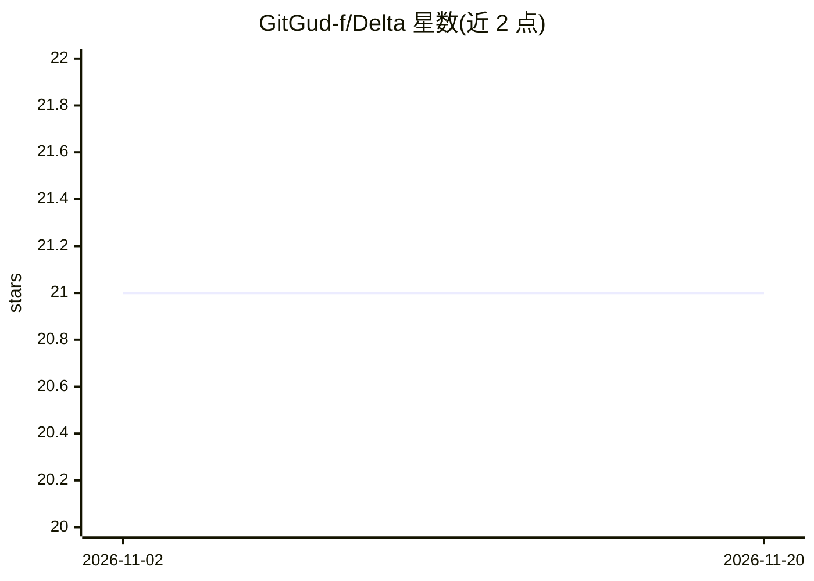

# GitGud-f/Delta

⭐ 21 · Jupyter Notebook · MIT · 推送 2026-11-01 · [GitHub](https://github.com/GitGud-f/Delta) · 组织维护

**面向边缘设备的轻量单目深度估计模型（3.4M 参数）**

通过知识蒸馏将 Depth Anything V2 (Small) 压缩为 MobileViT-XS 骨干 + MiniDPT 解码器的学生模型，共 3.4M 参数（约为教师的 1/7）。在 NYU Depth V2 上做零样本评测，Abs Rel 为 0.203；iPhone 13 上经 ONNX Runtime 推理 186ms。提供训练/蒸馏/ONNX 导出脚本与跨平台 Flutter 移动应用。限制：精度指标（Abs Rel/RMSE 等）与教师模型差距显著。

## 筛选速览

| 维度 | 判定 | 备注 |
|---|---|---|
| AI 角色 | `ai-native` | 本体是模型或模型工具 |
| 许可风险 | `permissive` | MIT |
| 部署形态 | `None` |  |
| 模型依赖 | — | README 未给出锁定关系 |
| 硬件要求 | — | 无带数字的原话,不猜 |
| 安装摩擦 | `low` | 无编译、无系统依赖或容器化 |
| 成熟度 | — | 结构信号不足 |

## 能力要点

- MobileViT-XS + MiniDPT 学生模型，3.4M 参数
- 复合蒸馏损失（SILog、梯度匹配、特征匹配、注意力图匹配）
- ONNX 导出与 Flutter 移动应用（Dart Isolates 后台推理）
- iPhone 13 上 186ms 推理（教师模型超过 10.7 秒）

## 适用场景

- 在手机等资源受限设备上运行近实时单目深度估计
- 学习/复现知识蒸馏压缩深度估计模型的完整流程
- 将压缩后的深度模型集成到跨平台移动应用

## 场景标签

`图像视频处理` · 领域:感知与多模态

## 证据(README 行号)

> L12: **Delta** is an end-to-end Edge AI framework for monocular depth estimation on resource-constrained devices. By lev
> L14: The resulting model contains only **3.4M parameters** (~7× smaller than the teacher) and achieves real-time inferen

## 星数曲线

2026-11-02 21 → 2026-11-20 21（+0）

---
*卡片 v1 · prompt 1.4 · 生成 2026-11-18 · 置信度 high · 依据 README sha `15c399403481` · [字段定义](../../DATASET.md)*
