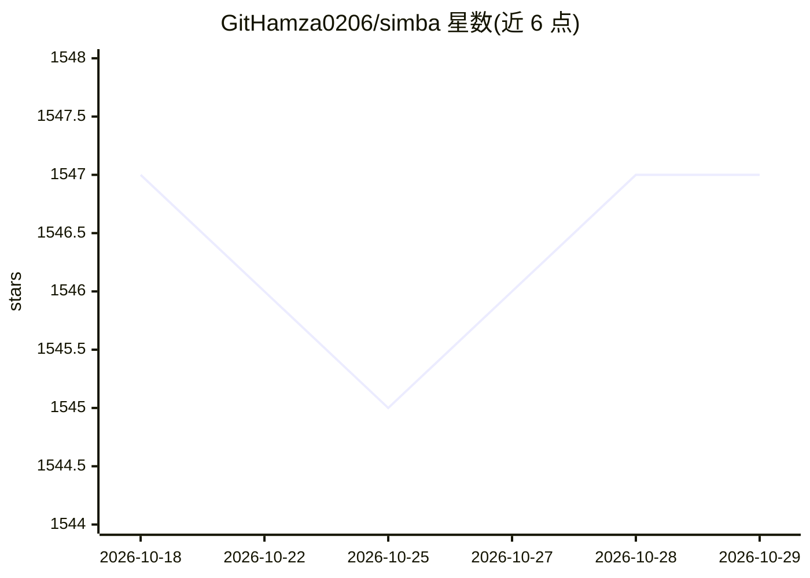

# GitHamza0206/simba

⭐ 1,547 · TypeScript · Apache-2.0 · 推送 2026-06-18 · [GitHub](https://github.com/GitHamza0206/simba) · [官网](https://simba.mintlify.app) · 个人维护

**开源自托管 AI 客服助手，内置评估与监控**

面向需要掌控 AI 的团队的开源客服助手：基于可定制的 RAG 管道接入自有知识库，可替换嵌入模型、LLM、向量库（Qdrant/FAISS/Chroma）、切块策略与重排器。内置评估框架，跟踪检索精度、生成忠实度、延迟与对话分析；提供管理文档和监控会话的 Dashboard。集成方式为 npm 聊天组件包一键嵌入网站；部署支持 Docker（CPU/CUDA）与 pip 手动安装，需配置 OpenAI API key。

## 筛选速览

| 维度 | 判定 | 备注 |
|---|---|---|
| AI 角色 | `ai-native` | 本体是模型或模型工具 |
| 许可风险 | `permissive` | Apache-2.0 |
| 部署形态 | `library` | 以包/库形式分发 |
| 模型依赖 | — | README 未给出锁定关系 |
| 硬件要求 | — | 无带数字的原话,不猜 |
| 安装摩擦 | `medium` | 含编译或系统依赖之一 |
| 成熟度 | — | 结构信号不足 |

## 能力要点

- 内置评估框架：检索/生成指标与对话分析（L40, L125-127）
- 组件全可替换：向量库、嵌入、LLM、重排器、解析器（L41, L152-158）
- npm 包一键在网站嵌入客服聊天组件（L42, L109）
- Docker（CPU/CUDA）与 pip 两种部署路径（L66-70, L80）

## 适用场景

- 在网站嵌入由自有知识库驱动的 AI 客服
- 团队自托管客服助手并持续评测其检索与回答质量
- 按需替换 LLM/向量库等组件搭建定制 RAG 客服管道

## 场景标签

`聊天机器人` `RAG` `模型评测` · 领域:对话与助手

## 证据(README 行号)

> L27: Simba is an open-source customer service assistant built for teams who need **full control** over their AI. Unlike 
> L33: |Can't measure AI quality|Built-in evaluation framework with retrieval and generation metrics|
> L40: - **Evaluation-First Design** - Track retrieval accuracy, generation quality, and latency out of the box. Know exac

## 星数曲线

2026-10-18 1,547 → 2026-10-29 1,547（+0）

---
*卡片 v1 · prompt 1.4 · 生成 2026-10-21 · 置信度 high · 依据 README sha `65f9bb77069d` · [字段定义](../../DATASET.md)*
