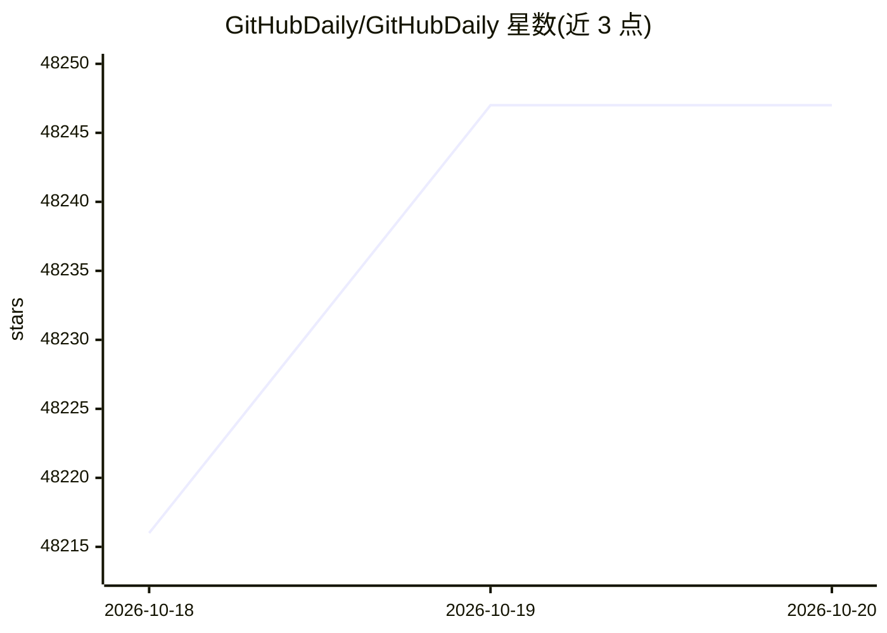

# GitHubDaily/GitHubDaily

⭐ 48,247 · 推送 2025-12-31 · [GitHub](https://github.com/GitHubDaily/GitHubDaily) · [官网](https://githubdaily.com) · 组织维护 · 中文 README

**面向开发者的 GitHub 开源项目分享与年度盘点清单**

GitHubDaily 自 2015 年起维护的开源项目分享仓库，累计分享超 10000 个项目，内容涵盖技术资料、开发者工具、编程网站与应用。README 按年份复盘并分类整理，2025 年部分设 AI 工具、后端、前端等目录，每条以表格形式给出项目名与简述；同时引导用户通过公众号、微博、知乎、X 等社交平台获取更新，并可在 issues 推荐或自荐项目。

## 筛选速览

| 维度 | 判定 | 备注 |
|---|---|---|
| AI 角色 | `ai-knowledge` | 知识聚合/清单类 |
| 许可风险 | `none` | — |
| 部署形态 | `self-host` | docker 或自建部署 |
| 模型依赖 | — | README 未给出锁定关系 |
| 硬件要求 | — | 无带数字的原话,不猜 |
| 安装摩擦 | `low` | 无编译、无系统依赖或容器化 |
| 成熟度 | `idea` | |

## 动量与使用信号

- 维护:`declining` — 距上次 push 290.5 天,年发版 0,4 位贡献者
- 涨星:近 1 天 **+16**(自 20261016 起算)
- 安装:github 包 `release-assets` 月下载无数据
- 平台:WINDOWS / MACOS / IOS · 协议:OPENAI-API / MCP / OLLAMA

## 能力要点

- 累计收录超 10000 个开源项目的分享清单
- 按年份（2018–2025）与领域分类整理复盘目录
- 通过 issues 接受项目推荐或自荐
- 同步运营公众号、微博、知乎、X 多个传播渠道

## 适用场景

- 想发现新的 AI 与开发者工具类开源项目
- 按年份回溯查找以往推荐过的项目
- 关注开源社区动态以扩展技术视野

## 场景标签

`精选清单` · 领域:学习与行业

## 证据(README 行号)

> L17: 秉着挖掘开源价值的初衷，GitHubDaily 自 2015 年 10 月 10 日正式成立。
> L21: 目前，GitHubDaily 已累积分享超过 10000 个开源项目，内容包括但不限于 GitHub 上的开源技术资料、开发者工具、编程网站以及成熟应用。
> L36: 下面是对 GitHubDaily 在 2025 年所推荐的项目进行分类整理，方便大家查找以往分享过的内容。

## 星数曲线

2026-10-18 48,216 → 2026-10-20 48,247（+31）

---
*卡片 v1 · prompt 1.4 · 生成 2026-10-18 · 置信度 mid · 依据 README sha `f550191a1105` · [字段定义](../../DATASET.md)*
