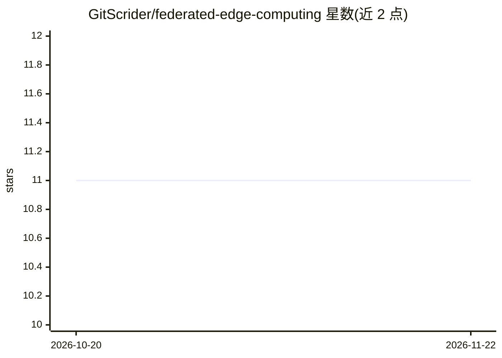

# GitScrider/federated-edge-computing

⭐ 11 · C · 推送 2026-10-12 · [GitHub](https://github.com/GitScrider/federated-edge-computing) · 个人维护

**面向 ESP32 等 IoT 设备的联邦学习框架**

由 C 编写的服务端（Linux，Makefile 构建）与基于 ESP-IDF 的 ESP32 客户端固件组成，通过 HTTP/WebSocket 经本地路由器进行模型分发与聚合，采用 FedAvg 聚合本地训练的模型。支持配置网络层数、激活函数（ReLU/Sigmoid/Perceptron/Softmax）、损失函数与 Lasso/Ridge 正则化，实时采集延迟与功耗指标。README 以 Iris 数据集（120 条，分片 3×40）为例演示联邦训练流程。硬件需求包括 ESP32 开发板与 Linux 设备作服务器。

## 筛选速览

| 维度 | 判定 | 备注 |
|---|---|---|
| AI 角色 | `ai-native` | 本体是模型或模型工具 |
| 许可风险 | `none` | — |
| 部署形态 | `None` |  |
| 模型依赖 | — | README 未给出锁定关系 |
| 硬件要求 | — | 无带数字的原话,不猜 |
| 安装摩擦 | `low` | 无编译、无系统依赖或容器化 |
| 成熟度 | — | 结构信号不足 |

## 能力要点

- C 实现的轻量级神经网络与联邦训练，受限于设备 RAM 的动态内存结构
- FedAvg 聚合，服务器经 HTTP/WebSocket 与多节点通信
- 实时采集延迟、消息交换与功耗指标
- 支持 ReLU/Sigmoid/Perceptron/Softmax、交叉熵/MSE 损失及 Lasso/Ridge 正则化

## 适用场景

- 在多个 ESP32 节点上做分布式本地训练并聚合全局模型
- 在边缘设备上评估延迟与功耗等训练指标
- 复现 README 中 Iris 数据集的联邦分类实验

## 场景标签

`模型训练` · 领域:训练与推理

## 证据(README 行号)

> L5: This framework enables federated learning implementation on ESP32 microcontrollers, allowing distributed training wi
> L17: The framework incorporates a federated learning architecture compatible with various models, constrained only by th

## 星数曲线

2026-10-20 11 → 2026-11-22 11（+0）

---
*卡片 v1 · prompt 1.4 · 生成 2026-11-19 · 置信度 high · 依据 README sha `907e75df843b` · [字段定义](../../DATASET.md)*
