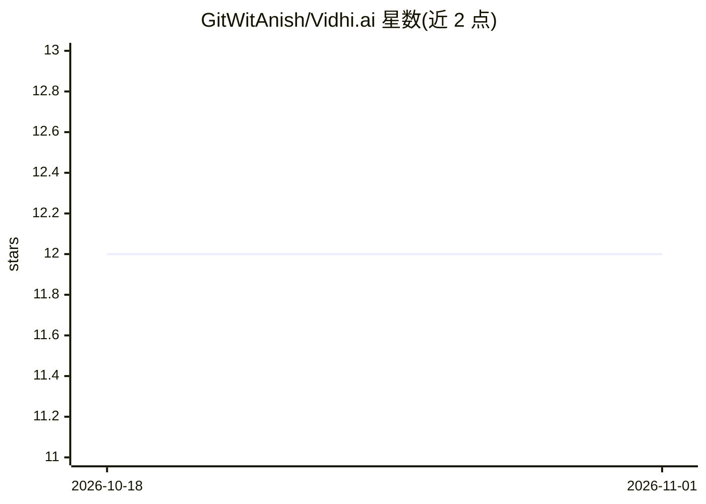

# GitWitAnish/Vidhi.ai

⭐ 12 · Python · MIT · 推送 2026-08-21 · [GitHub](https://github.com/GitWitAnish/Vidhi.ai) · [官网](https://team-pdf.vercel.app) · 组织维护

**面向尼泊尔用户的法律问答助手：基于尼泊尔法律的 RAG 引用回答**

面向尼泊尔公民的对话式法律助手：用户以英语或尼泊尔语自然语言提问，系统基于 35+ 部尼泊尔法律与法案（宪法、民法典、刑法典等）检索并生成带来源引用的回答，另提供政府服务办理步骤导航与语音问答。技术栈为 LLaMA 3.1 8B（经 HuggingFace）、SentenceTransformers MiniLM 嵌入、FAISS 向量检索，后端 FastAPI，前端 React 18 + Vite 或 Streamlit，语音使用 Edge TTS 与 Google 语音识别。README 未给出安装运行命令。

## 筛选速览

| 维度 | 判定 | 备注 |
|---|---|---|
| AI 角色 | `ai-native` | 本体是模型或模型工具 |
| 许可风险 | `permissive` | MIT |
| 部署形态 | `None` |  |
| 模型依赖 | — | README 未给出锁定关系 |
| 硬件要求 | — | 无带数字的原话,不猜 |
| 安装摩擦 | `low` | 无编译、无系统依赖或容器化 |
| 成熟度 | — | 结构信号不足 |

## 能力要点

- 基于 35+ 部尼泊尔法律文档的 RAG 问答，回答附原文引用
- 支持英语与尼泊尔语提问，含语音问答
- 政府服务办理的分步导航（含博卡拉谷地定制）
- FAISS 向量检索 + SentenceTransformers 嵌入

## 适用场景

- 用日常语言查询尼泊尔法律条文并获得带引用的回答
- 了解政府服务的办理步骤
- 通过语音提问获取法律解答

## 场景标签

`RAG` `文档问答` · 领域:知识与检索

## 证据(README 行号)

> L20: **VIDHI.AI** is a conversational AI that lets anyone ask legal questions in plain language and get accurate, cited 
> L41: |**LLM**|Meta LLaMA 3.1 8B (via HuggingFace)|

## 星数曲线

2026-10-18 12 → 2026-11-01 12（+0）

---
*卡片 v1 · prompt 1.4 · 生成 2026-11-01 · 置信度 mid · 依据 README sha `2ab3051f5ec7` · [字段定义](../../DATASET.md)*
