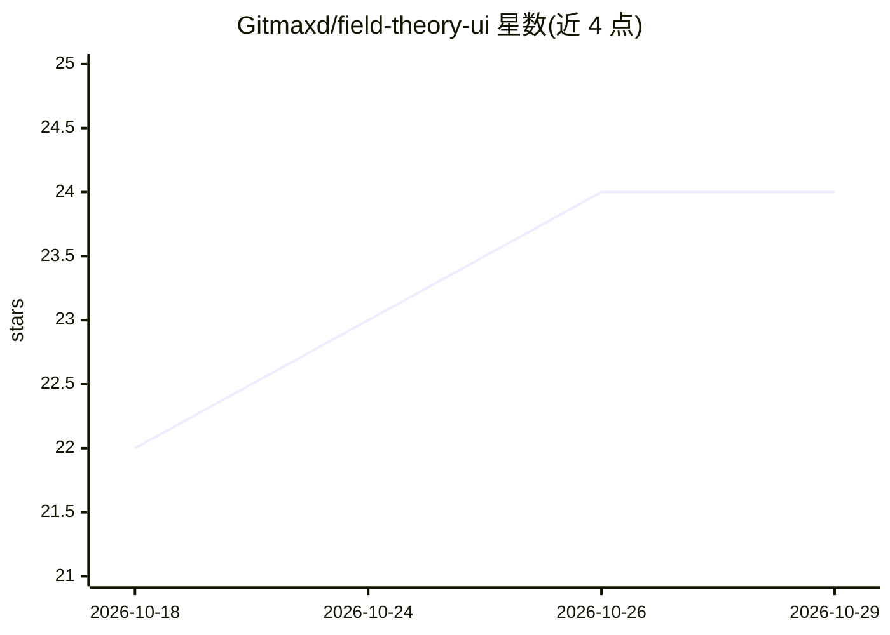

# Gitmaxd/field-theory-ui

⭐ 24 · TypeScript · MIT · 推送 2026-04-12 · [GitHub](https://github.com/Gitmaxd/field-theory-ui) · 个人维护

**本地优先的 X/Twitter 书签浏览 Web UI，含自然语言问答**

基于 fieldtheory CLI 的本地 Web 界面，读取已同步的书签 SQLite 数据库，提供全文搜索、作者分析、时间序列趋势、GitHub 仓库提取等 7 个只读视图。Chat 功能支持自然语言问答：标准模式无需 API key，借助 Claude Code CLI、Codex CLI 或内置模式匹配；Pro 模式通过 Anthropic 或 OpenAI API key 启用 LangChain ReAct agent，可调用沙箱只读 SQL 与 Tavily 网络搜索，并以 OpenUI 渲染交互式仪表盘。需 Node.js v20+ 与 fieldtheory CLI v1.2.0+。

## 筛选速览

| 维度 | 判定 | 备注 |
|---|---|---|
| AI 角色 | `ai-enhanced` | 去掉 AI 部分产品仍成立 |
| 许可风险 | `permissive` | MIT |
| 部署形态 | `library` | 以包/库形式分发 |
| 模型依赖 | locked-api |  |
| 硬件要求 | — | 无带数字的原话,不猜 |
| 安装摩擦 | `low` | 无编译、无系统依赖或容器化 |
| 成熟度 | — | 结构信号不足 |

## 能力要点

- 7 个只读视图：全文搜索、作者网格、月度趋势、GitHub 仓库提取等
- Pro 模式 LangChain ReAct agent，最多链式调用 8 次工具（沙箱只读 SQL + Tavily 搜索）
- 标准模式零 API key 即可用自然语言查询书签
- OpenUI 渲染流式生成的交互式图表与 KPI 仪表盘

## 适用场景

- 在本地浏览、过滤和检索我的 X/Twitter 书签
- 用自然语言问书签相关问题并获得交互式图表回答
- 追踪我收藏的 GitHub 仓库与兴趣随时间的变化

## 场景标签

`数据分析` · 领域:效率与自动化

## 证据(README 行号)

> L3: Local-first web interface for exploring your X/Twitter bookmarks. Built on the fieldtheory CLI.
> L9: - Search, filter, and explore thousands of bookmarks with full-text search
> L33: |**Chat**|Natural language Q&A with Pro mode interactive dashboards, token streaming, and copy/download actions|

## 星数曲线

2026-10-18 22 → 2026-10-29 24（+2）

---
*卡片 v1 · prompt 1.4 · 生成 2026-10-27 · 置信度 high · 依据 README sha `f24f8c4fd00c` · [字段定义](../../DATASET.md)*
