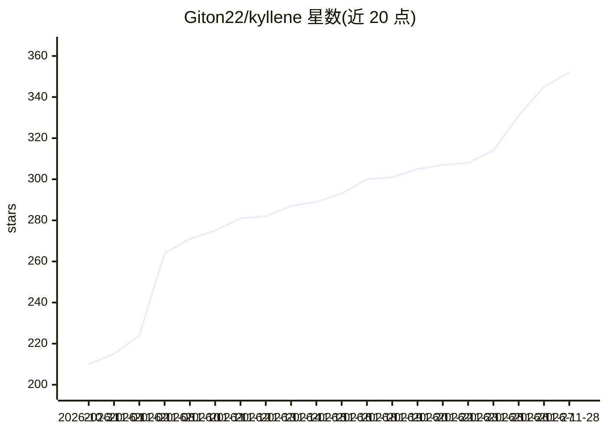

# Giton22/kyllene

⭐ 352 · Kotlin · MIT · 推送 2026-11-27 · [GitHub](https://github.com/Giton22/kyllene) · [官网](https://kyllene.app) · 个人维护

**自托管 Hermes Agent 的原生 Android 手机客户端**

连接用户自建的 hermes dashboard 网关的 Android 原生客户端，支持流式 Markdown/TeX 回复、命令执行审批、子代理与后台进程查看、会话侧边栏、定时任务、MCP/技能开关、成本与用量统计。提供设备端或网关端听写、免提语音聊天与通话，Wear OS 与 Pebble 手表端。无自建服务器与账号，直连网关；要求 Hermes Agent 0.22.0+，支持 SSO/OIDC 登录与 Cloudflare Access。提供 APK 安装包，桌面版为实验性。

## 筛选速览

| 维度 | 判定 | 备注 |
|---|---|---|
| AI 角色 | `ai-ecosystem` | LLM/agent 周边工具 |
| 许可风险 | `permissive` | MIT |
| 部署形态 | `None` |  |
| 模型依赖 | — | README 未给出锁定关系 |
| 硬件要求 | — | 无带数字的原话,不猜 |
| 安装摩擦 | `low` | 无编译、无系统依赖或容器化 |
| 成熟度 | — | 结构信号不足 |

## 能力要点

- 流式回复展示推理、工具活动与代码高亮，可中途追加消息或停止
- 命令审批、sudo、密钥提示可从通知栏直接处理
- 端到端加密的网外推送，不依赖 Google 服务
- 聊天离线加密副本与指纹/人脸应用锁

## 适用场景

- 在手机上远程监督并批准家中/VPS 上 agent 的操作
- 通过语音通话或手表与自己的 agent 对话
- 按项目组织会话并查看 token 与成本消耗

## 场景标签

`AI 助手` `聊天机器人` · 领域:对话与助手

## 证据(README 行号)

> L3: **A native Android client for Hermes Agent.**
> L21: same way Hermes Desktop's "Remote gateway" connection does. There is no Kyllene server and no account:
> L127: |**Hermes Agent**|Hermes Agent 0.22.0 or newer (tested to 0.23.4), with the dashboard running (`hermes dashboard`)

## 星数曲线

2026-10-31 210 → 2026-11-28 352（+142）

---
*卡片 v1 · prompt 1.4 · 生成 2026-11-28 · 置信度 high · 依据 README sha `5d3ab9e1db97` · [字段定义](../../DATASET.md)*
