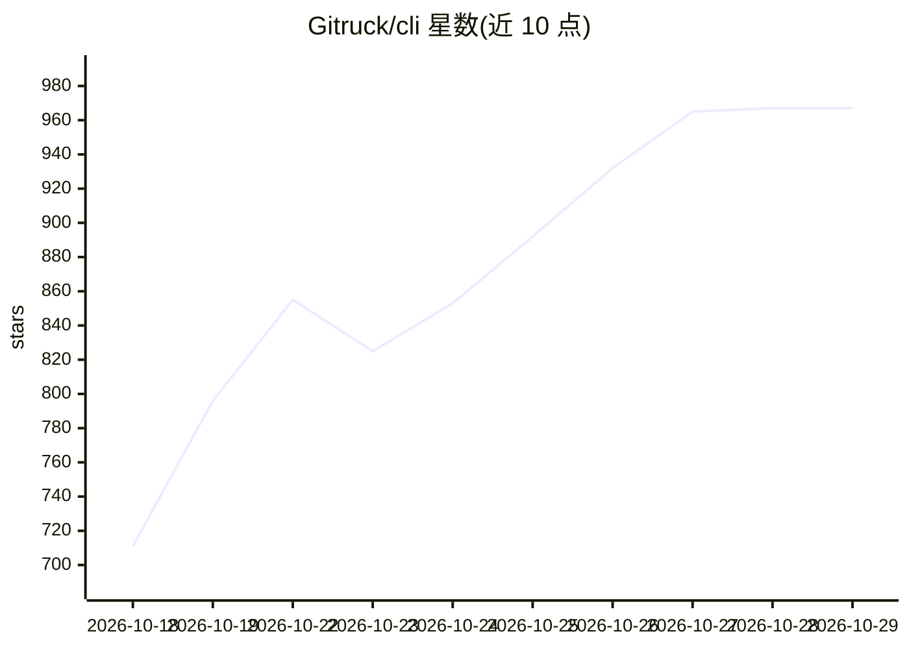

# Gitruck/cli

⭐ 967 · TypeScript · MIT · 推送 2026-10-25 · [GitHub](https://github.com/Gitruck/cli) · [官网](https://ai-mcn.tv/gtrk) · 组织维护 · 中文 README

**给 AI Agent 用的视频创作 CLI：口播毛片变可精修剪辑工程**

gtrk 是面向 AI Agent 的视频创作命令行工具：在 Codex、Claude Code、Cursor 等支持 Skills 的 Agent 中描述需求，Agent 调用 CLI 执行口播粗剪、高光切片、解说配音、配画面、字幕与动效装配，产出带多轨时间线的 .gtrk 工程，可在配套客户端精修并导出到剪映、Premiere XML、FCPXML、OTIO。也可脱离 Agent 直接用命令操作。依赖 Node.js≥20.6 与 FFmpeg；云端分析与渲染能力（同合云）需 API Key 并按量计费，CLI 本体 MIT 开源。桌面客户端目前仅提供 Windows 版。

## 筛选速览

| 维度 | 判定 | 备注 |
|---|---|---|
| AI 角色 | `ai-enhanced` | 去掉 AI 部分产品仍成立 |
| 许可风险 | `permissive` | MIT |
| 部署形态 | `library` | 以包/库形式分发 |
| 模型依赖 | — | README 未给出锁定关系 |
| 硬件要求 | — | 无带数字的原话,不猜 |
| 安装摩擦 | `medium` | 含编译或系统依赖之一 |
| 成熟度 | — | 结构信号不足 |

## 能力要点

- Agent 驱动的口播/访谈/解说等剪辑工作流，产出可继续精修的工程
- 导出剪映、Premiere XML、FCPXML、OTIO 保留精修时间线
- 可与 AI Drama Desk 衔接，把分镜生成的片段铺回工程轨道
- 提供单点工具箱（抠像、降噪、人声分离、超分、补帧等）

## 适用场景

- 把口播毛片粗剪并包装成带字幕、BGM 的成片
- 从长访谈中挑出高光话题切成横竖屏短片
- 给旅拍/美食素材写解说、配音并配画面
- 将剪辑工程导出到剪映或 Premiere 继续精修

## 场景标签

`图像视频处理` `语音合成` · 领域:内容生成

## 证据(README 行号)

> L22: **gtrk 是为 AI Agent 准备的视频创作 CLI。** 在 Codex、Claude Code、Cursor、TRAE 等支持 Skills 的 Agent 里说需求，Agent 调用 gtrk 完成剪辑与装配，你在客
> L59: ```bash
> L113: - **在你熟悉的 Agent 里创作。** 配套 Skills 负责组织步骤，CLI 负责执行；也能直接接入脚本和自动化流程。

## 星数曲线



2026-10-18 711 → 2026-10-29 967（+256）


---
*卡片 v1 · prompt 1.4 · 生成 2026-10-21 · 置信度 high · 依据 README sha `c68b60a5ea7b` · [字段定义](../../DATASET.md)*
