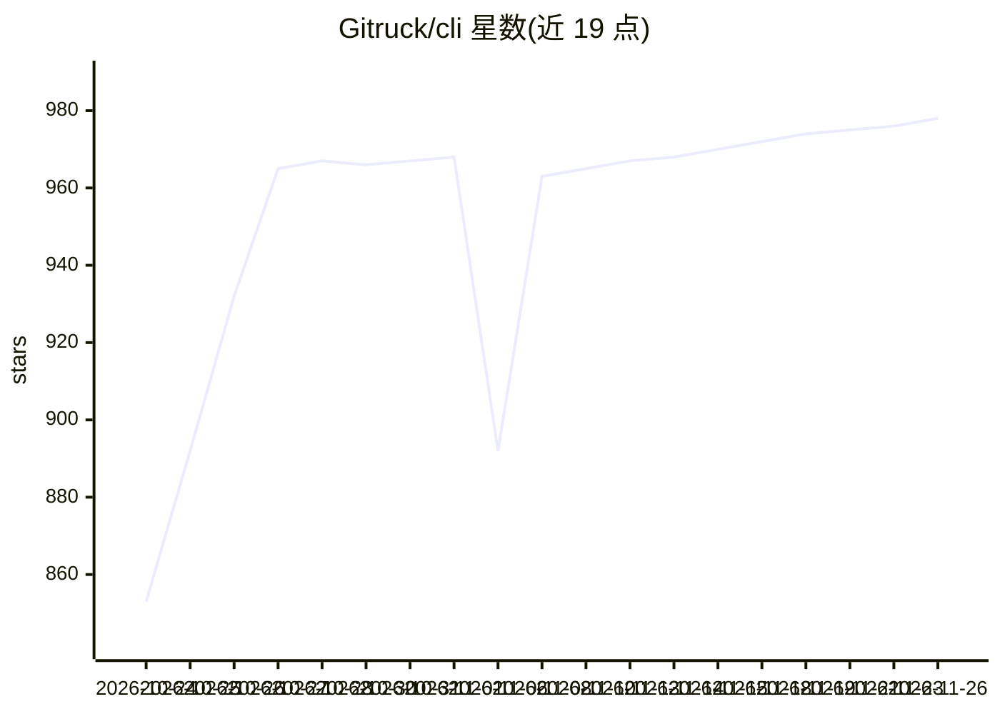

# Gitruck/cli

⭐ 978 · TypeScript · MIT · 推送 2026-10-30 · [GitHub](https://github.com/Gitruck/cli) · [官网](https://ai-mcn.tv/gtrk) · 组织维护 · 中文 README

**给 AI Agent 用的视频剪辑 CLI：把口播毛片变成可精修工程**

gtrk 是为支持 Skills 的 AI Agent（Codex、Claude Code、Cursor、TRAE 等）准备的视频创作 CLI：用户在 Agent 里描述需求，Agent 调用 gtrk 完成口播粗剪、长剪短、解说配音、配画面、字幕等剪辑装配，产出可继续精修的视频工程。工程可在 Windows 桌面客户端预览精修，并导出剪映、Premiere XML、FCPXML 或 OTIO。CLI 代码 MIT 开源，但分析与渲染调用同合云，需 API Key 且按量计费。

## 筛选速览

| 维度 | 判定 | 备注 |
|---|---|---|
| AI 角色 | `ai-native` | 本体是模型或模型工具 |
| 许可风险 | `permissive` | MIT |
| 部署形态 | `library` | 以包/库形式分发 |
| 模型依赖 | — | README 未给出锁定关系 |
| 硬件要求 | — | 无带数字的原话,不猜 |
| 安装摩擦 | `medium` | 含编译或系统依赖之一 |
| 成熟度 | — | 结构信号不足 |

## 能力要点

- 口播粗剪、长剪短、配音解说、配画面、字幕等多条工作流，可整体或单点调用
- 导出剪映/Premiere XML/FCPXML/OTIO 工程，保留精修时间线
- 配套 Skills 安装到 Claude Code/Codex 等Agent，无需写代码即可用自然语言创作
- 单点工具箱支持抠像、降噪、人声分离、超分、补帧、译制

## 适用场景

- 把口播或访谈毛片剪成结构完整、可二次精修的成片工程
- 从播客/课程/直播回放中挑出高光做成多条短片
- 给旅拍或探店素材写解说、配音并配画面
- 把成片导出到剪映或 Premiere 继续手工精修

## 场景标签

`视频生成` · 领域:内容生成

## 证据(README 行号)

> L22: **gtrk 是为 AI Agent 准备的视频创作 CLI。** 在 Codex、Claude Code、Cursor、TRAE 等支持 Skills 的 Agent 里说需求，Agent 调用 gtrk 完成剪辑与装配，你在客
> L134:     B <--> C["同合云分析与处理"]
> L189: CLI 代码采用 MIT 许可证；同合云能力按对应规则计费，你使用的 Agent 和第三方生成服务也可能单独收费。价格与额度以控制台和计费说明为准。

## 星数曲线

2026-10-24 853 → 2026-11-26 978（+125）

---
*卡片 v1 · prompt 1.4 · 生成 2026-11-24 · 置信度 high · 依据 README sha `643573b44ee0` · [字段定义](../../DATASET.md)*
