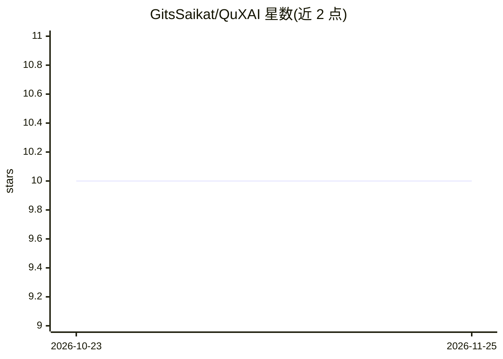

# GitsSaikat/QuXAI

⭐ 10 · Python · Apache-2.0 · 推送 2026-05-08 · [GitHub](https://github.com/GitsSaikat/QuXAI) · [官网](https://arxiv.org/abs/2505.10167) · 个人维护

**混合量子机器学习模型的可解释性 Python 框架**

面向混合量子-经典机器学习模型的 Python 解释框架：提供量子专用的解释方法，支持对混合量子-经典模型的决策进行理解与解读，附带可视化工具、预构建量子模型与数据处理流水线。仓库含 explainers、models、plotting、experiments 等模块，通过 pip 安装 requirements.txt 使用，以 Apache 2.0 许可发布并附引用条目。

## 筛选速览

| 维度 | 判定 | 备注 |
|---|---|---|
| AI 角色 | `ai-native` | 本体是模型或模型工具 |
| 许可风险 | `permissive` | Apache-2.0 |
| 部署形态 | `library` | 以包/库形式分发 |
| 模型依赖 | — | README 未给出锁定关系 |
| 硬件要求 | — | 无带数字的原话,不猜 |
| 安装摩擦 | `low` | 无编译、无系统依赖或容器化 |
| 成熟度 | — | 结构信号不足 |

## 能力要点

- 提供量子专用的模型解释方法
- 支持混合量子-经典机器学习模型
- 附带可解释性可视化工具与预构建量子模型
- 含面向量子 ML 的数据处理流水线

## 适用场景

- 解读量子 ML 模型的决策依据
- 对混合量子-经典模型做可解释性分析
- 可视化量子模型的解释结果

## 场景标签

 · 领域:量子计算/可解释机器学习

## 证据(README 行号)

> L9: QuXAI is a Python-based framework that provides explanation methods for hybrid quantum-classical machine learning mo
> L13: - Implementation of quantum-specific explanation methods

## 星数曲线

2026-10-23 10 → 2026-11-25 10（+0）

---
*卡片 v1 · prompt 1.4 · 生成 2026-11-20 · 置信度 high · 依据 README sha `591ce1ab9ecd` · [字段定义](../../DATASET.md)*
