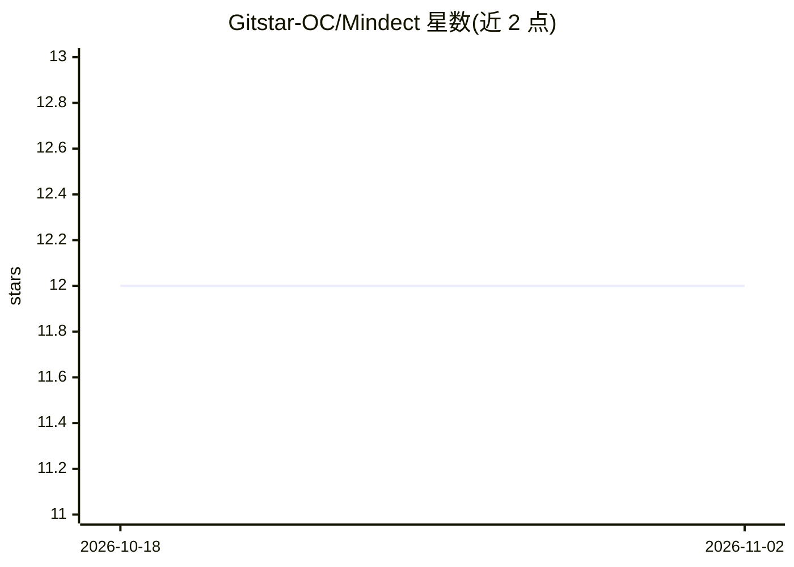

# Gitstar-OC/Mindect

⭐ 12 · Jupyter Notebook · NOASSERTION · 推送 2026-10-27 · [GitHub](https://github.com/Gitstar-OC/Mindect) · [官网](https://mindect.vercel.app) · 组织维护

**面向所有人的 AI/ML/深度学习教学文档站**

Mindect 是一个基于 Next.js/MDX 构建的学习文档站点，内容覆盖 AI、机器学习、监督学习与高阶学习算法，并附带数学内容，面向想入门 AI/ML 的学习者。README 声明项目当前处于不活跃状态（服务器资源占用与用户活跃度原因）。本地开发方式为克隆仓库后 npm install 并 npm run dev 启动开发服务器，贡献需阅读贡献指南。

## 筛选速览

| 维度 | 判定 | 备注 |
|---|---|---|
| AI 角色 | `ai-knowledge` | 知识聚合/清单类 |
| 许可风险 | `none` | NOASSERTION |
| 部署形态 | `library` | 以包/库形式分发 |
| 模型依赖 | — | README 未给出锁定关系 |
| 硬件要求 | — | 无带数字的原话,不猜 |
| 安装摩擦 | `low` | 无编译、无系统依赖或容器化 |
| 成熟度 | — | 结构信号不足 |

## 能力要点

- 内容覆盖 AI、ML、监督学习与高阶学习算法及数学
- 基于 Next.js/TypeScript/MDX 的文档站点
- 提供本地开发服务器启动步骤（npm install / npm run dev）

## 适用场景

- 初学者系统学习 AI 与机器学习基础概念
- 作为可贡献的开源教育文档项目参与（hacktoberfest/good-first-issue）

## 场景标签

`教程课程` · 领域:学习与行业

## 证据(README 行号)

> L7: - Mindect are docs for everyone who wants to learn about AI, ML, Supervised Learning and Advanced Learning ALgorithm

## 星数曲线

2026-10-18 12 → 2026-11-02 12（+0）

---
*卡片 v1 · prompt 1.4 · 生成 2026-11-01 · 置信度 high · 依据 README sha `962c2d4b2e5b` · [字段定义](../../DATASET.md)*
