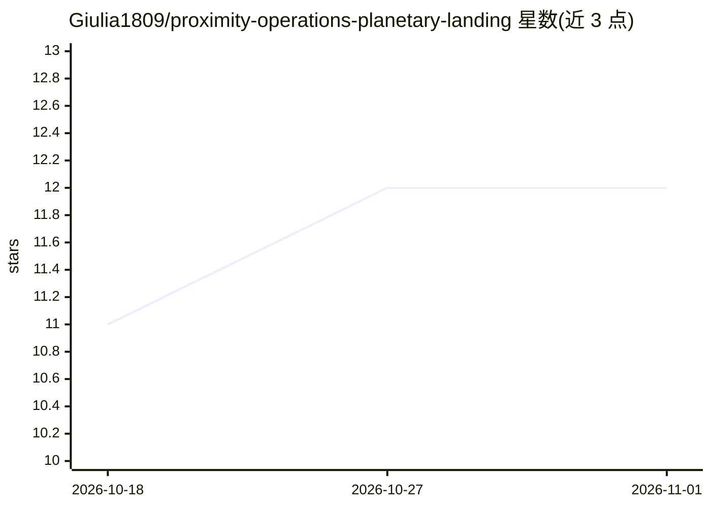

# Giulia1809/proximity-operations-planetary-landing

⭐ 12 · Python · Apache-2.0 · 推送 2025-12-11 · [GitHub](https://github.com/Giulia1809/proximity-operations-planetary-landing) · 个人维护

**行星着陆（月球/火星等）近距离操作物理仿真器**

提供 Python 绑定、兼容 ROS、可定制的行星着陆物理仿真器集合，物理引擎基于 Bullet/PyBullet，覆盖月球、火星、土卫六等天体的 EDL（进入-下降-着陆）末段仿真与精确着陆轨迹重规划（避障）场景。仿真器配套三篇深度强化学习与迁移学习论文，要求使用时引用。仓库由论文作者（Ciabatti 等，涉及 JPL/NASA 关联作者）维护，面向航天器自主着陆的 RL 策略研究。

## 筛选速览

| 维度 | 判定 | 备注 |
|---|---|---|
| AI 角色 | `ai-ecosystem` | LLM/agent 周边工具 |
| 许可风险 | `permissive` | Apache-2.0 |
| 部署形态 | `None` |  |
| 模型依赖 | — | README 未给出锁定关系 |
| 硬件要求 | — | 无带数字的原话,不猜 |
| 安装摩擦 | `low` | 无编译、无系统依赖或容器化 |
| 成熟度 | — | 结构信号不足 |

## 能力要点

- Bullet/PyBullet 真实物理引擎驱动的着陆仿真
- 支持月球、火星、土卫六等多种天体场景
- Python 绑定与 ROS 兼容、可定制
- 包含 EDL 末段仿真与精确着陆轨迹重规划（避障）两套仿真器

## 适用场景

- 训练与评估行星自主着陆的强化学习策略
- 在物理仿真中研究避障轨迹重规划
- 为航天器 EDL 末段控制算法提供测试环境

## 场景标签

`强化学习` · 领域:训练与推理

## 证据(README 行号)

> L5: Find here a gathering of useful Python-binded, ROS-compatible, customizable, real-physics (Bullet/PyBullet physical 
> L14: 1. Learning Transferable Policies for Autonomous Planetary Landing via Deep Reinforcement Learning

## 星数曲线

2026-10-18 11 → 2026-11-01 12（+1）

---
*卡片 v1 · prompt 1.4 · 生成 2026-11-01 · 置信度 mid · 依据 README sha `eacc0d2b9168` · [字段定义](../../DATASET.md)*
