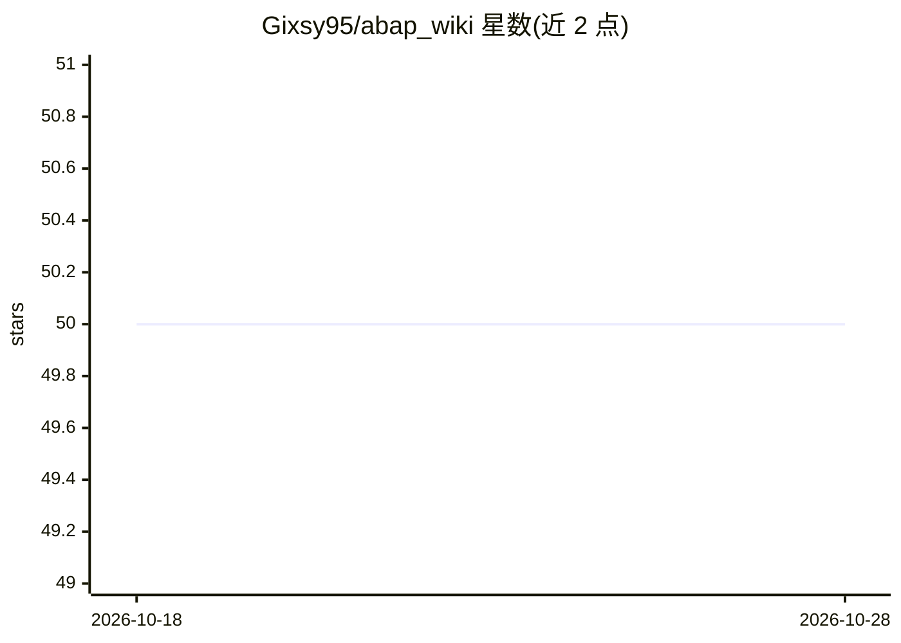

# Gixsy95/abap_wiki

⭐ 50 · Python · MIT · 推送 2026-09-21 · [GitHub](https://github.com/Gixsy95/abap_wiki) · 个人维护

**把 SAP S/4HANA 定制对象编译成可验证知识库的 agent 引擎**

本地运行的 agent 驱动引擎：从 SAP 系统的定制对象（Z*/Y*）出发，沿依赖向外追踪标准对象，经 L0 清单→L1 代码分析→L2 功能与流程的分层管线，生成带 wikilink 的纯 Markdown 知识库（推荐用 Obsidian 浏览）。每条声明锚定到源码行（[VERIFIED: path:N-M]），由独立对抗性 judge agent 在不同模型上复核，fail-closed：无证据不晋升。面向 SAP 工程师与 AI agent 双读者；需要 Python 3.11+、Git 与一个 agentic coding runner（Claude Code 或 Codex CLI）驱动 L1/L2，L0 确定性运行不耗 token。全本地运行，无外部连接；README 含模型对比基准与 token 节省度量。

## 筛选速览

| 维度 | 判定 | 备注 |
|---|---|---|
| AI 角色 | `ai-ecosystem` | LLM/agent 周边工具 |
| 许可风险 | `permissive` | MIT |
| 部署形态 | `None` |  |
| 模型依赖 | locked-api |  |
| 硬件要求 | — | 无带数字的原话,不猜 |
| 安装摩擦 | `low` | 无编译、无系统依赖或容器化 |
| 成熟度 | — | 结构信号不足 |

## 能力要点

- L0→L1→L2→L3 分层管线，产出带依赖图与回链的 Obsidian vault
- 对抗性 gate：作者/judge 分模型独立会话，ACCEPT 或 REVERT，fail-closed
- 每条声明锚定 [VERIFIED: path:N-M] 源码行号
- 100% 本地运行，支持 Claude Code / Codex CLI 或全本地开源 agent

## 适用场景

- 把遗留 SAP 系统的定制对象文档化成可导航知识库
- 为 AI agent 提供带引用的预验证上下文，替代对原始 ABAP 做 RAG
- SAP 系统交接时保留设计与流程决策（why）的知识

## 场景标签

`知识库管理` · 领域:知识与检索

## 证据(README 行号)

> L39: `abap_wiki` is a **local, agent-driven engine** that turns an SAP S/4HANA system into a
> L71: **⚙️ A real harness, not a prompt.** This isn't "ask Claude to document my code." It's a
> L72: tight agentic harness (gates, contracts, a state machine, citations) built on years of

## 星数曲线

2026-10-18 50 → 2026-10-28 50（+0）

---
*卡片 v1 · prompt 1.4 · 生成 2026-10-24 · 置信度 high · 依据 README sha `203675299b9c` · [字段定义](../../DATASET.md)*
