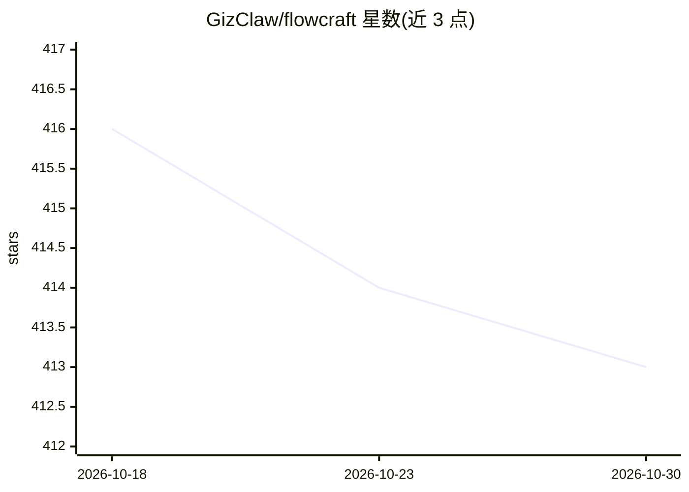

# GizClaw/flowcraft

⭐ 413 · Go · MIT · 推送 2026-10-29 · [GitHub](https://github.com/GizClaw/flowcraft) · [官网](https://gizclaw.github.io/flowcraft/) · 组织维护 · 中文 README

**Go 编写的模块化 AI agent 框架：记忆、推理与插件组装**

面向 Go 开发者的 AI 应用构建工具集，核心模块 core 提供 agent 执行、图引擎、工具、推理与记忆契约；driver 模块提供 OpenAI、Anthropic、ByteDance、MiniMax、DashScope 等推理适配器；craft 层通过 craft.yaml 定义、编译期能力与 MCP 插件宿主完成应用组装。记忆作为可插拔实现注册，支持检查点暂停恢复与事件流。各层为独立版本化 Go 模块，附 forge 工作区演示与 anvil 最小宿主示例。

## 筛选速览

| 维度 | 判定 | 备注 |
|---|---|---|
| AI 角色 | `ai-ecosystem` | LLM/agent 周边工具 |
| 许可风险 | `permissive` | MIT |
| 部署形态 | `library` | 以包/库形式分发 |
| 模型依赖 | — | README 未给出锁定关系 |
| 硬件要求 | — | 无带数字的原话,不猜 |
| 安装摩擦 | `low` | 无编译、无系统依赖或容器化 |
| 成熟度 | — | 结构信号不足 |

## 能力要点

- core 模块提供 agent 执行、图引擎、工具、推理与记忆契约
- driver 提供 OpenAI/Anthropic/ByteDance/MiniMax/DashScope 等推理适配器，DeepSeek、GLM 走 OpenAI 驱动
- craft 层支持 craft.yaml 定义、MCP 插件宿主与热插拔、蓝绿替换
- Checkpoint 契约支持跨重启暂停恢复 agent

## 适用场景

- 在 Go 服务中嵌入多提供商 agent 运行时
- 以声明式图编排 agent 工作流并接入长期记忆
- 通过插件与能力扩展组装可热插拔的 AI 应用

## 场景标签

`Agent 框架` `Agent 记忆` · 领域:Agent 开发

## 证据(README 行号)

> L3: **A modular Go toolkit for extensible AI applications, long-term memory, provider backends, and local interactive wo
> L10: FlowCraft is a Go workspace for building and evaluating AI applications without
> L18: - **`core`** — The single platform module: agent execution, graph, tool,

## 星数曲线

2026-10-18 416 → 2026-10-30 413（-3）

---
*卡片 v1 · prompt 1.4 · 生成 2026-10-21 · 置信度 mid · 依据 README sha `5f7e2cf42a2f` · [字段定义](../../DATASET.md)*
