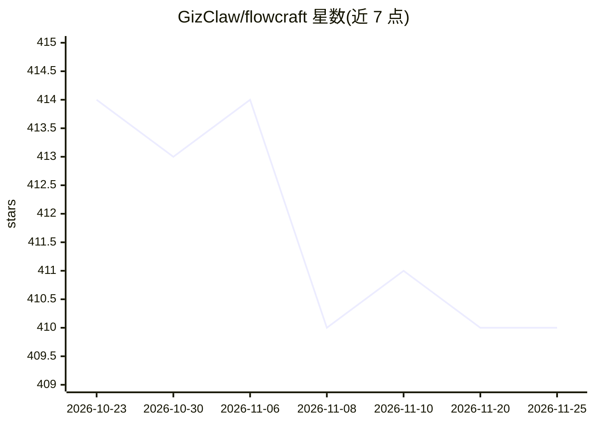

# GizClaw/flowcraft

⭐ 410 · Go · MIT · 推送 2026-11-20 · [GitHub](https://github.com/GizClaw/flowcraft) · [官网](https://gizclaw.github.io/flowcraft/) · 个人维护 · 中文 README

**Go 语言 AI agent 构建平台：用 YAML 声明部署，自行持有运行时**

FlowCraft 是一个 Go 工作区，用于构建 AI agent 部署：以部署文档（deploy.yaml、运行时层、图文档）声明哪些 agent 存在、各自运行在什么引擎与协议上、被允许做什么。core 模块提供消息与权限契约、推理、工具、沙箱、运行时与遥测；graph 引擎以 frontier 循环执行可含环的图，agent 执行支持检查点与事件日志的持久化；沙箱提供 local/bwrap/seatbelt/windows 四种后端。以 Go 模块形式被嵌入应用，也可运行 examples/forge 的狼人杀 TUI 演示。core 与 driver 处于 pre-1.0，破坏性变更可能随 minor 版本发布。

## 筛选速览

| 维度 | 判定 | 备注 |
|---|---|---|
| AI 角色 | `ai-ecosystem` | LLM/agent 周边工具 |
| 许可风险 | `permissive` | MIT |
| 部署形态 | `library` | 以包/库形式分发 |
| 模型依赖 | — | README 未给出锁定关系 |
| 硬件要求 | — | 无带数字的原话,不猜 |
| 安装摩擦 | `low` | 无编译、无系统依赖或容器化 |
| 成熟度 | `idea` | |

## 能力要点

- 三个文件声明一个部署，构建前逐文件校验，未注册的 kind 报错而非静默跳过
- 图引擎支持 frontier 循环，ReAct 循环即边，无拓扑排序与环拒绝
- 沙箱边界含 local/bwrap/seatbelt/windows 后端，权限只能收窄不能放宽
- agent 执行以投影加 append-only 事件日志做检查点，支持按指纹校验的恢复

## 适用场景

- 在 Go 服务中嵌入可控的 agent 运行时并自行持有提示与持久化策略
- 以声明式 YAML 管理多 agent 部署与 agent 间委托
- 运行本地 forge 演示做多 agent 自对弈测试

## 场景标签

`Agent 框架` `多智能体` · 领域:Agent 开发

## 证据(README 行号)

> L10: FlowCraft is a Go workspace for building agent deployments without tying
> L22: - **`core`** — the platform module: message and permission contracts, inference
> L148: `core/agent-graph` runs a graph as a frontier loop, so a ReAct cycle is just

## 星数曲线

2026-10-23 414 → 2026-11-25 410（-4）

---
*卡片 v1 · prompt 1.4 · 生成 2026-11-25 · 置信度 mid · 依据 README sha `b15199e676d6` · [字段定义](../../DATASET.md)*
