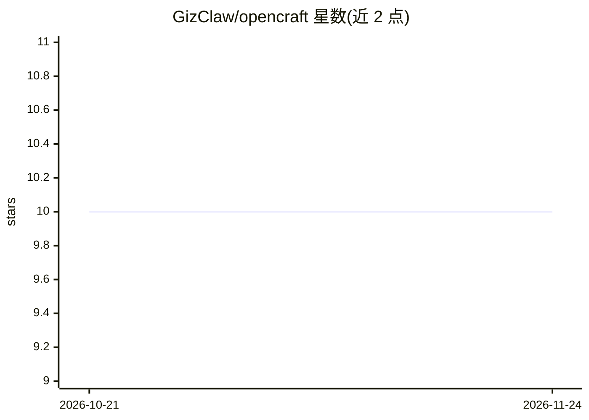

# GizClaw/opencraft

⭐ 10 · Go · MIT · 推送 2026-11-20 · [GitHub](https://github.com/GizClaw/opencraft) · 个人维护 · 中文 README

**本地优先的桌面 AI 工作伙伴：文件/命令/多智能体代理**

基于 flowcraft 配置驱动图引擎的本地桌面应用（Wails v3 + React），可读取与编辑文件、在审批下执行 shell 命令、协调子智能体并持久化/恢复会话。推理侧支持为多个提供商配置多实例与自定义端点，路由带重试回退；工具链含文件组、PTY 执行、补丁、网页抓取等，配中间件（截断缓存、32k 结果上限、密钥脱敏、JSONL 审计）。提供 macOS/Linux/Windows 安装包，macOS 亦可 Homebrew cask 安装；源码构建需 Go 1.26+、Node 22 与 Wails v3。

## 筛选速览

| 维度 | 判定 | 备注 |
|---|---|---|
| AI 角色 | `ai-native` | 本体是模型或模型工具 |
| 许可风险 | `permissive` | MIT |
| 部署形态 | `desktop` | 安装包/桌面程序 |
| 模型依赖 | locked-api |  |
| 硬件要求 | — | 无带数字的原话,不猜 |
| 安装摩擦 | `low` | 无编译、无系统依赖或容器化 |
| 成熟度 | — | 结构信号不足 |

## 能力要点

- 本地 execd 沙箱与 per-workspace 审批策略（seatbelt/bwrap）
- 多提供商多实例推理配置，路由优先级与重试回退
- 子智能体委派看板与会话恢复/导出，SQLite 会话存储
- 中间件安全链：密钥脱敏、结果上限、JSONL 审计与 SSRF 门控

## 适用场景

- 让代理在本机完成文件整理、编码与命令执行等工作流
- 需要审批与审计机制的本地命令执行代理
- 配置多家模型端点并按优先级自动回退
- 通过技能安装与子智能体拆解多步骤任务

## 场景标签

`编码 Agent` `多智能体` `工作流自动化` `AI 助手` · 领域:Agent 开发

## 证据(README 行号)

> L16: opencraft is a work partner that runs on your machine: it reads and edits
> L19: engine, it helps with coding and beyond — orchestrating any local workflow.
> L27: - **Chat & sessions** — streaming reasoning, tool calls, and output blocks;

## 星数曲线

2026-10-21 10 → 2026-11-24 10（+0）

---
*卡片 v1 · prompt 1.4 · 生成 2026-11-20 · 置信度 high · 依据 README sha `d376ed078a33` · [字段定义](../../DATASET.md)*
