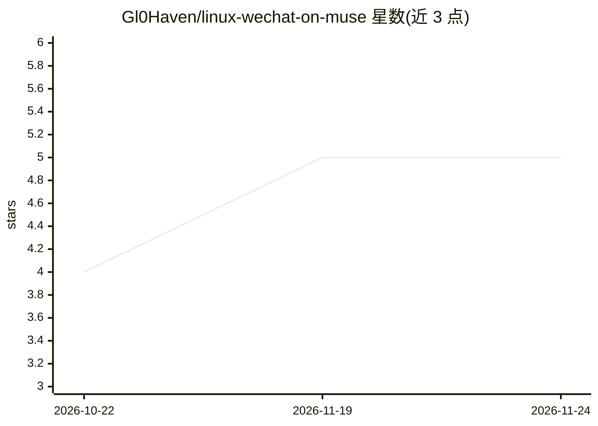

# Gl0Haven/linux-wechat-on-muse

⭐ 5 · Python · MIT · 推送 2026-10-12 · [GitHub](https://github.com/Gl0Haven/linux-wechat-on-muse) · 个人维护 · 中文 README

**将微信 Linux 客户端消息接入 AI 助手的桥接器**

桥接微信 Linux 客户端与 AI 助手的消息管线：通过 tail SQLite WAL 读取群聊/私聊消息并做回复价值分类，经带租约机制的 SQLite 队列流转，由 agent 运行时生成回复，再经 GUI 自动化（xdotool/剪贴板）写回聊天窗口并通过 WAL 验证送达；附群游戏、定时摘要、表情库等扩展模块。需运行于 Xvfb 虚拟显示下的官方客户端，README 警告自动化操作可能违反微信用户协议导致封号。

## 筛选速览

| 维度 | 判定 | 备注 |
|---|---|---|
| AI 角色 | `ai-native` | 本体是模型或模型工具 |
| 许可风险 | `permissive` | MIT |
| 部署形态 | `library` | 以包/库形式分发 |
| 模型依赖 | — | README 未给出锁定关系 |
| 硬件要求 | — | 无带数字的原话,不猜 |
| 安装摩擦 | `low` | 无编译、无系统依赖或容器化 |
| 成熟度 | — | 结构信号不足 |

## 能力要点

- tail 微信客户端 SQLite WAL 读取消息并分类是否需回复
- SQLite 消息队列（NEW→SENT 状态机）支持多 worker 租约防重复处理
- 单点 GUI 写入器负责导航聊天、粘贴回复并经 WAL 校验送达
- keepalive.sh 与健康监控维持客户端、代理、读写组件常驻

## 适用场景

- 让 AI 助手代读并回复微信群消息
- 定时向群推送新闻或摘要
- 在群里运行故事投票/问答/抽卡类机器人游戏

## 场景标签

`聊天机器人` · 领域:对话与助手

## 证据(README 行号)

> L3: A bridge that connects the **WeChat Linux client** to an AI assistant, so the assistant can read group/DM messages a
> L34: Reply generation is **not** a standalone LLM client. It was built to run inside the Muse agent runtime: a scheduled

## 星数曲线

2026-10-22 4 → 2026-11-24 5（+1）

---
*卡片 v1 · prompt 1.4 · 生成 2026-11-21 · 置信度 mid · 依据 README sha `edb586a1b4f6` · [字段定义](../../DATASET.md)*
