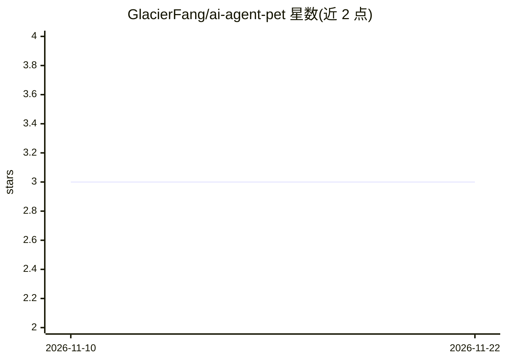

# GlacierFang/ai-agent-pet

⭐ 3 · Python · NOASSERTION · 推送 2026-11-19 · [GitHub](https://github.com/GlacierFang/ai-agent-pet) · 个人维护 · 中文 README

**桌面 ESP32-S3 宠物屏，实时显示 AI agent 运行状态**

一块 ESP32-S3 加 2.4 英寸 ST7789 屏的桌面设备，通过订阅本机 OpenClaw gateway 的会话状态，把 agent 的运行、等待审批、完成、出错映射为宠物六种状态，由服务端 petd 用 Pillow 渲染 240×320 JPEG 经 WebSocket 推屏。屏幕为哑终端，业务逻辑全在 Python 服务端，改动不用刷固件。支持无硬件模拟器先跑通；真机需按 BOM 购件并烧录固件（预编译固件在 Releases）。数据全部留在本机，无账号无云端，维护者不接受 PR。

## 筛选速览

| 维度 | 判定 | 备注 |
|---|---|---|
| AI 角色 | `ai-ecosystem` | LLM/agent 周边工具 |
| 许可风险 | `none` | NOASSERTION |
| 部署形态 | `library` | 以包/库形式分发 |
| 模型依赖 | — | README 未给出锁定关系 |
| 硬件要求 | — | 无带数字的原话,不猜 |
| 安装摩擦 | `low` | 无编译、无系统依赖或容器化 |
| 成熟度 | — | 结构信号不足 |

## 能力要点

- 服务端 Pillow 渲染 JPEG 推屏，设备端零中文字库、加功能不刷固件
- 六种宠物状态映射 agent 会话，等待审批为最高优先级状态
- KY-040 旋钮四类手势，语义表在服务端可改配置生效
- 自带模拟设备、后台控制台及五个设备端小游戏

## 适用场景

- agent 后台跑任务时在桌面看到它是否在等我批准
- 不打断手头工作的前提下盯多个 agent 会话的进度
- 私有化环境里远程掌握本机 agent 的出错与完成通知

## 场景标签

 · 领域:AI agent 工具/桌面硬件

## 证据(README 行号)

> L20: > 🟢 **服务端已落地并实测**。petd 订阅 OpenClaw gateway，把会话状态映射成宠物的六种状态，用 Pillow 渲染成 240×320 的 JPEG 推给设备。单测全绿，CI 覆盖 Python 3.10 
> L37: 1. **脑子在 Pi，屏幕是哑终端** — 业务逻辑全在 petd，设备端只做「收帧显示 + 按键上报」。改功能不用刷固件。

## 星数曲线

2026-11-10 3 → 2026-11-22 3（+0）

---
*卡片 v1 · prompt 1.4 · 生成 2026-11-22 · 置信度 mid · 依据 README sha `dfbaeddb50af` · [字段定义](../../DATASET.md)*
